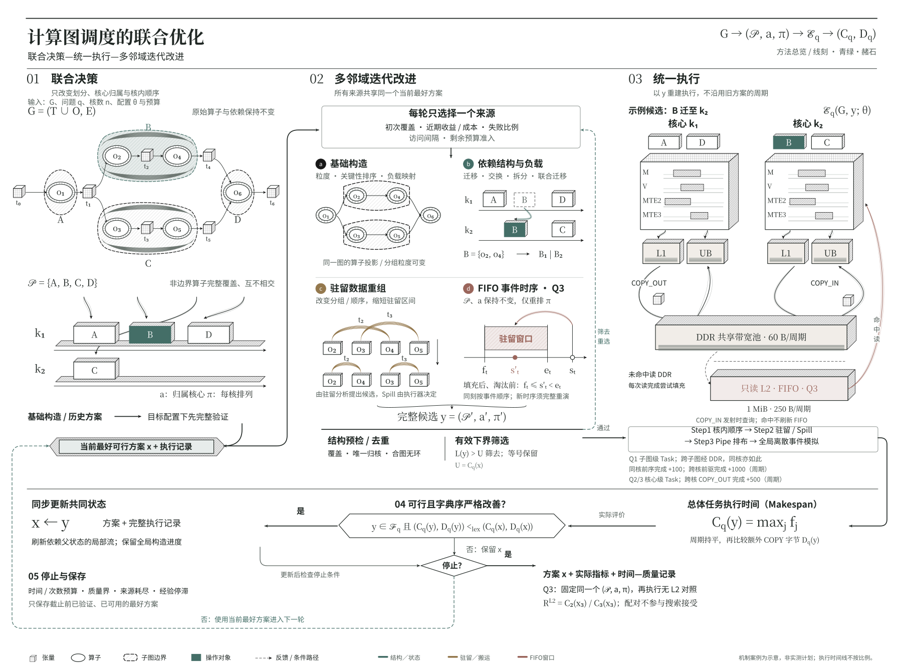

# A 题论文图件 · 第二版流程图入口

当前总流程图采用 **线刻设色第二版（ink_v2）**，默认配色为青绿·赭石。编辑、排版和后续图件维护请从第二版目录开始。

- [第二版流程图与四套配色](engraved_workflow/ink_v2/README.md)：可编辑 SVG／SVGZ、矢量 PDF、高清 PNG、预览和生成脚本。
- [流程图目录与版本说明](engraved_workflow/README.md)：第二版主入口及第一版源母版的关系。
- [可复用线刻设色工具](ink_engraving_agent/README.md)：角色色板、SVG 和 Matplotlib 样式适配器。
- [图件维护 Agent](ink_engraving_agent/AGENT.md)：后续流程图及数据图的制作规范。

第一版黑白母版保存在 `engraved_workflow/assets/workflow.svg`，第二版生成器需要读取它；直接用于展示和论文排版的成图位于 `engraved_workflow/ink_v2/`。
