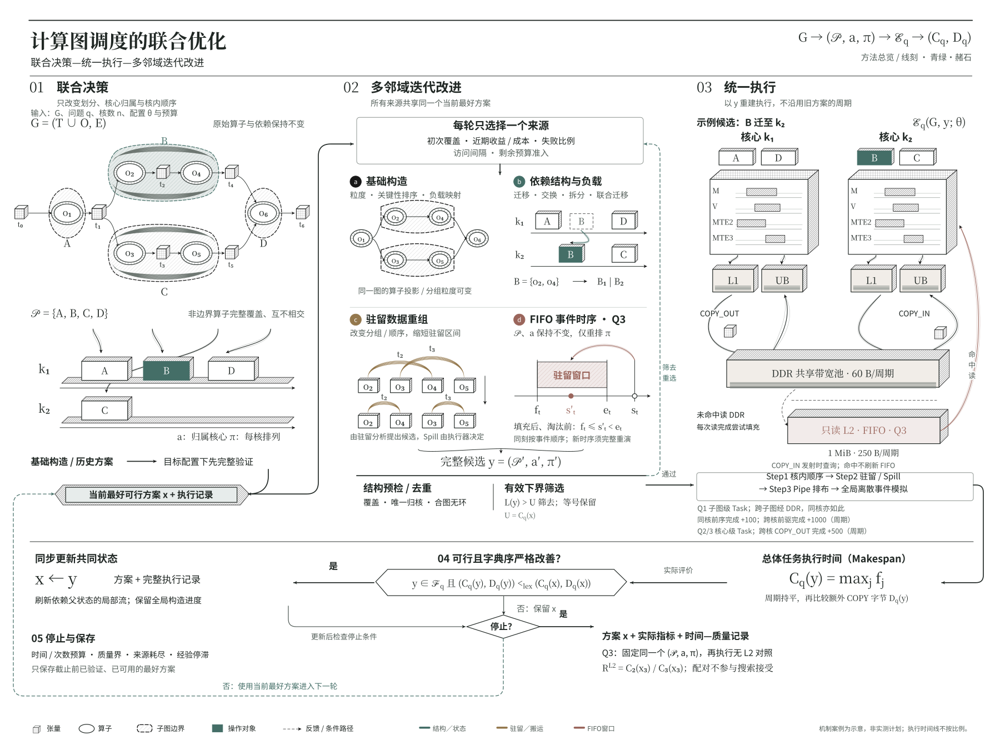

# 计算图调度的联合优化 · 线刻设色总流程图（第二版）

当前展示和编辑入口是 **[第二版 ink_v2](ink_v2/README.md)**，默认使用青绿·赭石配色。第二版保留六算子案例、子图包络、核心剖面和细排线，并整理跨模块主流程、外侧反馈通道及右下角目标公式留白。



## 第二版文件与编辑入口

| 文件 | 用途 |
| --- | --- |
| [workflow_qinglu.svg](ink_v2/assets/workflow_qinglu.svg) / [SVGZ](ink_v2/assets/workflow_qinglu.svgz) | 默认青绿版可编辑母版，保留文字、具名图层和矢量对象 |
| [workflow_qinglu.pdf](ink_v2/exports/workflow_qinglu.pdf) | 默认青绿版矢量 PDF，用于论文排版 |
| [workflow_qinglu.png](ink_v2/exports/workflow_qinglu.png) | 默认青绿版高清 PNG |
| [workflow_qinglu_preview.png](ink_v2/exports/workflow_qinglu_preview.png) | 第二版预览 |
| [四套配色与构建说明](ink_v2/README.md) | 青绿、浅绛、烟岚、灰阶的完整资产表 |
| [第二版生成器](ink_v2/build.py) | 从第一版源母版生成第二版 SVG，并可导出 PDF／PNG |
| [方法与来源对齐](ink_v2/docs/SOURCE_ALIGNMENT.md) | 第二版与 workshop_v2 的对应关系 |
| [原包制作记录](ink_v2/docs/LOCAL_REVIEW.md) / [整合记录](ink_v2/docs/BUNDLE_INTEGRATION.md) | 图件制作与本次仓库整合的记录 |
| [线刻设色工具](../ink_engraving_agent/README.md) | 共用角色色板与后续数据图风格适配 |

## 生成第二版

在仓库根目录运行，Python 3.10 或更新版本即可生成四套可编辑 SVG：

```bash
python paper_a_figures/engraved_workflow/ink_v2/build.py --all-palettes --svg-only
```

安装 Inkscape 并将其加入 PATH 后，可重新导出四套 PDF、6000 像素 PNG 和 1800 像素预览：

```bash
python paper_a_figures/engraved_workflow/ink_v2/build.py --all-palettes
```

仓库已经包含交付包中的 SVG、SVGZ、PDF、高清 PNG 和预览，查看与使用这些文件无需先运行构建命令。字体与不同 Inkscape 版本可能影响重新导出的字形度量；字体文件不随图件分发。

## 阅读主线

从同一计算图形成联合决策，经共同当前最好状态进入候选来源；每轮选择一个来源，预检与有效下界筛选后进入固定执行器。实际 Makespan 和次级 COPY 字节用于严格接受判定，下一轮通过外侧通道反馈到共同状态。停止后保存已验证结果；第三问同方案无 L2 配对位于输出侧。

A–D、o1–o6、t0–t6 是机制示例。图中区间和 Pipe 活动不按实际周期比例绘制，图件未添加实验成绩。

## 第一版源母版与历史记录

`assets/workflow.svg` 是第一版黑白源母版，也是第二版生成器的固定输入。第一版的 `src/`、`build.py`、`assets/`、`exports/`、`tests/` 和 `docs/` 保留，供源对象编辑与制作过程追溯。运行本目录的旧 `build.py` 会生成第一版；生成当前第二版请使用上面的 `ink_v2/build.py` 命令。

[第一版来源映射](docs/SOURCE_MAP.md)、[第一版制作过程](docs/PROCESS.md) 和 [AI 辅助记录](docs/AI_USAGE.md) 描述第一版阶段；第二版说明以 `ink_v2/` 内文档为准。现有 `.github/workflows/engraved-workflow.yml` 仍是第一版的历史构建工作流，第二版复现命令见本页和第二版 README。

手动编辑第二版 SVG 时请另存文件；长期维护可修改 `ink_v2/build.py` 和共用色板后重新生成。第二版生成器始终读取第一版源母版，避免把上次生成的第二版再次作为输入。
