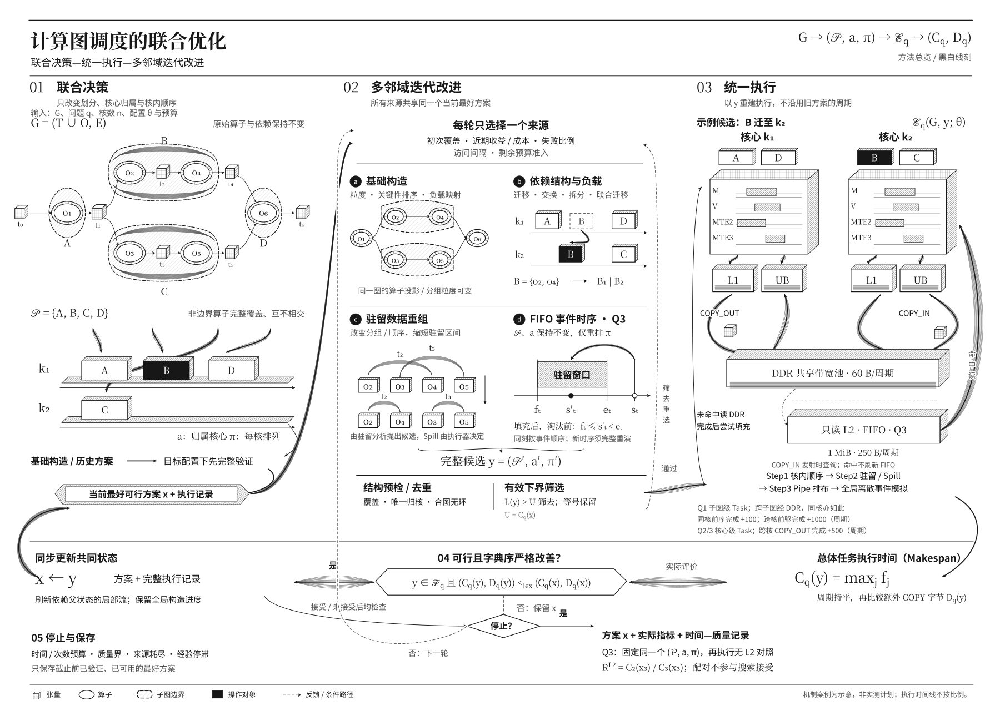

# 计算图调度的联合优化 · 黑白线刻总流程图



这是独立的新图件工作区。没有沿用旧总流程图的布局或绘图代码，也不覆盖论文、求解器、官方评估器和已有实验结果。母版以黑白线刻、张量格、子图包络、核心剖面和收束曲线建立后续图件的共同语言。

## 文件与编辑入口

| 文件 | 用途 |
| --- | --- |
| `assets/workflow.svg` | 可编辑母版；真实 text/tspan、节点、路径和具名图层，无嵌入位图 |
| `exports/workflow.pdf` | A3 横向矢量图，文字可搜索；适合排版和放大查看 |
| `exports/workflow.png` | 6000 像素宽成图 |
| `exports/workflow_preview.png` | 1800 像素宽预览 |
| `assets/style_guide.svg` / `exports/style_guide.pdf` | 线宽、材质、对象、文字层级的可复用样式页 |
| `src/draw_workflow.py` | 主要作图源代码，Python 标准库生成 SVG |
| `src/draw_style_guide.py` | 使用相同绘图组件的样式页 |
| `assets/example_case.json` | 贯穿案例的拓扑、分组与示意次序 |
| `tests/test_workflow.py` | 结构、示意案例和关键术语检查 |
| `docs/SOURCE_MAP.md` | 方法、题面机制与图中位置的逐项对应 |
| `docs/PROCESS.md` | 构图、绘制、检查、导出、提交的过程记录 |
| `docs/PROVENANCE.json` | 输入与理论快照的校验记录 |
| `docs/AI_USAGE.md` | AI 辅助绘图范围 |

SVG 可直接在 Inkscape 中编辑。五个主要图层及内部案例组有独立名称。修改文字无需解除轮廓；箭头、曲线、节点、存储剖面均为矢量对象。`src/draw_workflow.py` 中 `Drawing` 负责通用组件，`input_plate`、`neighborhoods`、`execution_plate`、`control_and_outputs` 负责各部分布局。

**两种修改路径不要混用：**手动编辑 SVG 后另存版本；重新运行生成器会重建母版。长期维护优先修改源代码。`example_case.json` 是案例语义与测试数据，坐标和文字目前在 Python 中显式绘制，并非修改 JSON 即可自动重新排版。

## 本地复现

需要 Python 3.10 或更新版本。仅生成 SVG 使用标准库：

```bash
python3 paper_a_figures/engraved_workflow/build.py --svg-only
```

导出 PDF/PNG 另需 Inkscape CLI 与字体。Ubuntu 示例：

```bash
sudo apt-get update
sudo apt-get install inkscape fonts-noto-cjk fonts-stix poppler-utils
python3 paper_a_figures/engraved_workflow/build.py
```

也可进入本目录运行 `python3 build.py`。Windows 安装 Python、Inkscape 及 Noto CJK 字体，并把 Inkscape 的 `bin` 加入 PATH 后运行 `python build.py`。不依赖远程生图服务，绘图脚本没有网络请求。项目不附带字体文件；PDF 导出保留所需字体子集。

`python3 build.py --png-width 9000` 可更改高分辨率 PNG 的宽度。默认 6000；预览固定 1800。SVG 的逻辑画布为 3000 × 2120，物理尺寸约 420 × 296.8 mm。此为密集总图，建议 A3 横向整页或数字放大阅读，不建议缩成双栏论文中的半栏小图；后续可按图层拆分为局部方法图。

## 阅读主线

从左侧同一计算图形成联合决策，经共同当前最好状态进入中间的候选来源。每轮选择一个来源，预检与有效下界筛选后进入右侧固定执行器。底部以实际 Makespan 和次级 COPY 字节判定是否严格接受，再反馈到共同状态。停止后保存已验证结果；第三问同方案无 L2 配对位于输出侧，不参与搜索接受。

A–D、o1–o6、t0–t6 是贯穿机制示例，不是某个实测 case 的结果。图中区间和 Pipe 活动用于解释机制，不按实际周期比例绘制。图上未添加实验成绩。

## 自动构建与 PR

仓库工作流 `.github/workflows/engraved-workflow.yml` 仅针对本目录变更运行。它生成源 SVG、PDF/PNG 和校验报告，并上传 Actions artifact。在本次同仓库专用 PR 分支上，工作流只提交本目录的 `assets/` 与 `exports/`，使成图与制作源文件一起留在 PR；不自动合并、不修改论文正文或实验数据。其他分支只构建并上传 artifact。

本地首次视觉检查使用 Inkscape 1.4 与 Poppler。不同系统的 Inkscape/字体版本可能影响文字度量和 PDF 二进制内容；提交的 SVG 由标准库确定性生成，便于审核差异。`exports/build_report.json` 保存实际渲染器与画布边界检查结果。
