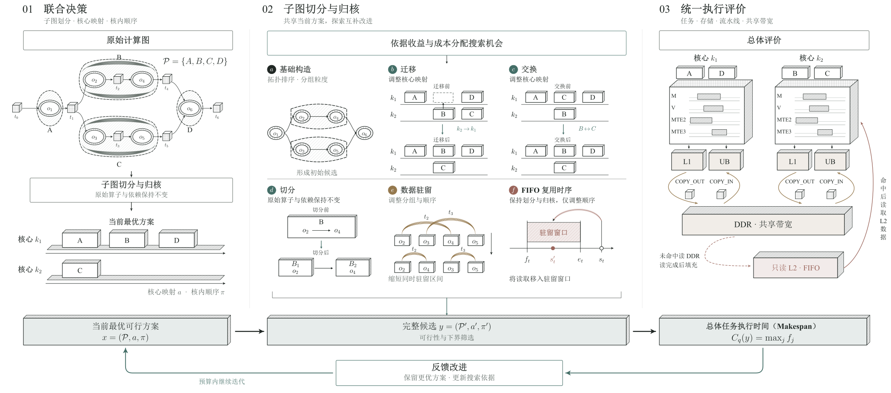
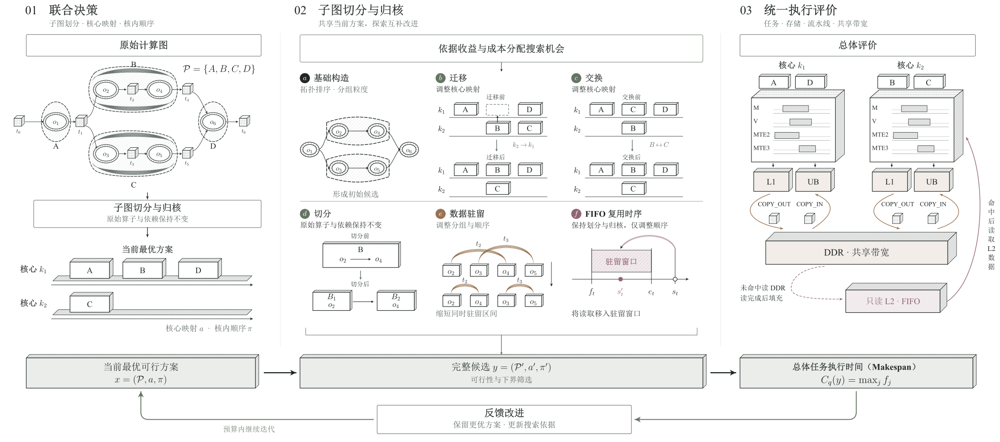
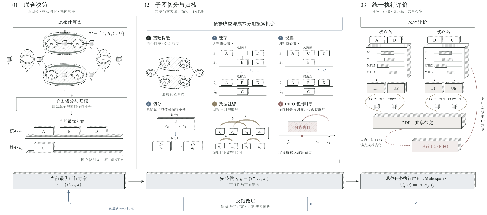
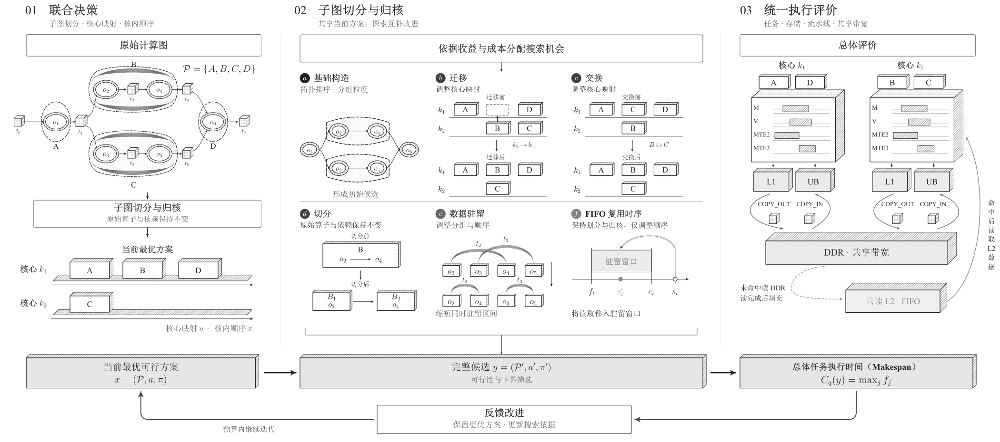

# 图1.1 · 第十一版（ink_v11）

基于已发布的第九版，仅统一命中/未命中两处说明的字体、字号和颜色，并补全命中含义。只新增本目录，保留旧图、PR #69 现稿、求解代码及实验数据。

## 本轮修改

右侧原竖排“命中读”改为 **“命中后读取 L2 数据”**，保持竖排、L2 同行。与左侧“未命中读 DDR / 读完成后填充”统一为 **中文 SimSun（宋体）、西文 Times New Roman、25 SVG 用户单位字号、常规字重、各配色的正文墨色**。25 是 SVG 画布字号，不是论文中的 25 pt。原未命中说明本身保持不变。

新字使用第九版已发布的原生字形轮廓；不重新排整图，不依赖本机字体，不替换字体。其余所有文字、公式、箭头、COPY 标注、张量立方体、存储块、布局及配色均保持第九版。四套配色同步修改，几何与文字相同。

## 四套配色

### 青绿·赭石

[矢量PDF](exports/workflow_qinglu_v11.pdf) · [便携SVG](assets/workflow_qinglu_v11.svg) · [可编辑SVG](assets/workflow_qinglu_v11_editable.svg) · [SVGZ](assets/workflow_qinglu_v11.svgz) · [高清PNG](exports/workflow_qinglu_v11.png)

### 浅绛·苔色

[矢量PDF](exports/workflow_qianjiang_v11.pdf) · [便携SVG](assets/workflow_qianjiang_v11.svg) · [可编辑SVG](assets/workflow_qianjiang_v11_editable.svg) · [SVGZ](assets/workflow_qianjiang_v11.svgz) · [高清PNG](exports/workflow_qianjiang_v11.png)

### 烟岚·石青

[矢量PDF](exports/workflow_yanlan_v11.pdf) · [便携SVG](assets/workflow_yanlan_v11.svg) · [可编辑SVG](assets/workflow_yanlan_v11_editable.svg) · [SVGZ](assets/workflow_yanlan_v11.svgz) · [高清PNG](exports/workflow_yanlan_v11.png)

### 墨线·灰阶

[矢量PDF](exports/workflow_mono_v11.pdf) · [便携SVG](assets/workflow_mono_v11.svg) · [可编辑SVG](assets/workflow_mono_v11_editable.svg) · [SVGZ](assets/workflow_mono_v11.svgz) · [高清PNG](exports/workflow_mono_v11.png)

SVG 画布为 3500×1550；单页矢量 PDF 为 490×217 毫米；高清 PNG 为 6000×2657，预览为 2100×930。便携 SVG 和 PDF 已转曲；可编辑 SVG 保留 107 个文字对象，编辑时需要本机具备对应字体。交付不含字体文件。

## PR #69 配套正文

[一段式论文正文及插入说明](docs/PAPER_TEXT_PR69.md) · [LaTeX 图文替换片段](docs/PR69_figure_and_text.tex)

正文以整图流程为主，涵盖联合方案、a—f 候选、三问使用范围、统一评价与反馈、只读 L2 命中/未命中及最终配对。图文片段保留原 `fig:roadmap` 标签。本次没有直接修改或重新编译已合并 PR #69 的论文。

## 重建与实际核验

```bash
python -m pip install fonttools==4.63.0 pymupdf==1.26.7 pillow==12.3.0
# 系统须安装 Inkscape，并保留相邻的 ink_v9 目录。
python paper_a_figures/engraved_workflow/ink_v11/build.py --all
python paper_a_figures/engraved_workflow/ink_v11/verify.py
python paper_a_figures/engraved_workflow/ink_v11/review.py
```

[核验记录](docs/LOCAL_REVIEW.md) · [自动核验JSON](docs/VERIFICATION.json) · [已审SVG的SHA256](docs/REVIEWED_SVG_SHA256.json) · [四色整图](docs/four_palettes_review.png) · [四色局部](docs/four_palettes_cache_detail.png) · [青绿局部](docs/cache_labels_detail.png)

构建锁定八份 V9 源 SVG 的 Git blob。核验将新说明恢复为原三个文字对象并恢复版本元数据后，要求 XML 与 V9 完全相同；同时检查未命中说明未变、字体字号字重颜色、四色几何、SVG 引用、SVGZ、PNG 尺寸及 PDF 资源。相同 Inkscape 渲染器的 V9/V11 像素对比要求命中说明区域外变化像素数为 0；另用 MuPDF 独立渲染全部 PDF，检查整图与局部。
