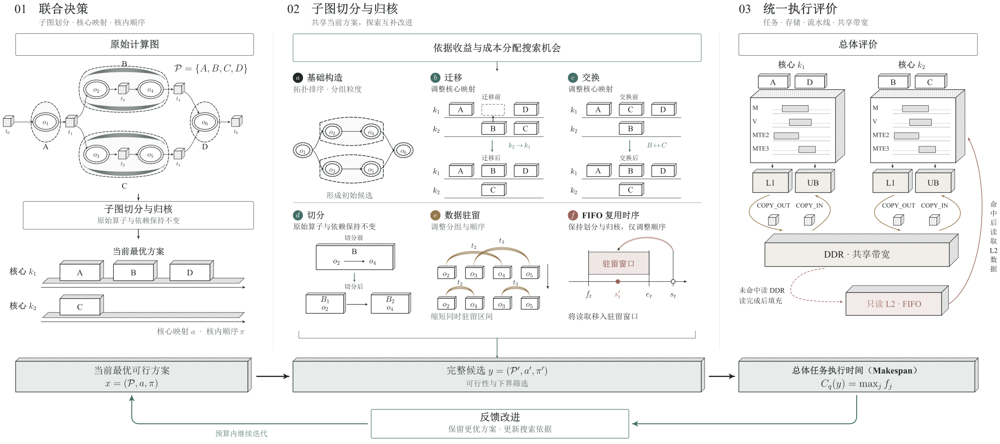
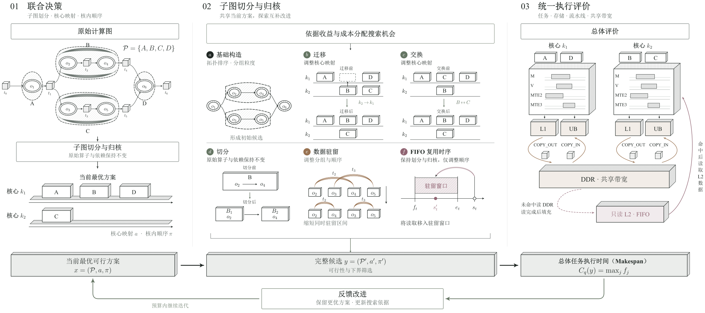
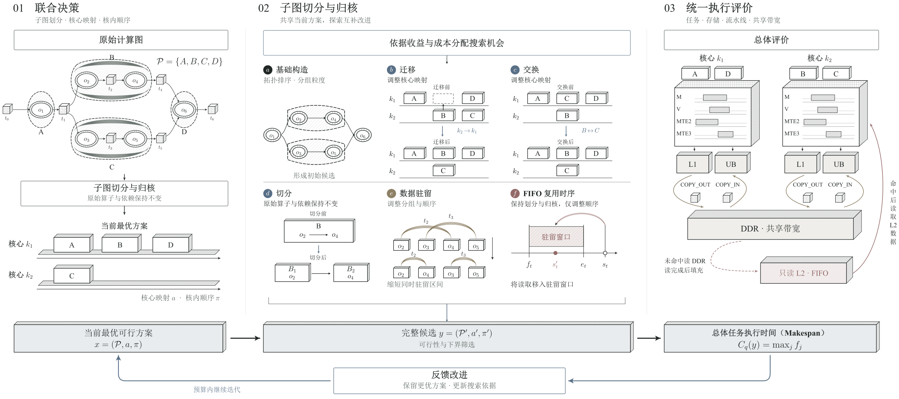
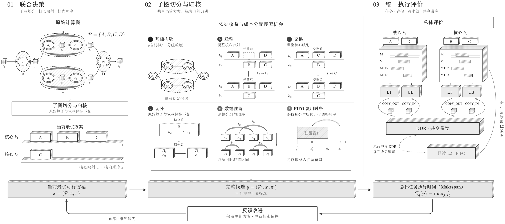

# 图1.1 · 第十二版（ink_v12）

基于已发布第十一版，保持图内所有对象与结构不变，提供 A4 纵向正文和横向整页两种排版。只新增本目录，不覆盖旧版本、论文、求解代码或实验数据。

## 纸面放大，而非只增加像素

现稿 `workshop_v2/论文/论文.tex` 设置 A4 四边 25 mm 页边距，因此纵向版心宽 160 mm，横置图页宽 247 mm。第十一版已经接近满宽；在相同 160 mm 中，将整个 SVG 坐标和画布同时乘倍数不会使纸上的字变大。

本版将原 `0 235 3500 1550` 视口收紧为 `38 240 3454 1536`，保留所有可见对象及安全余量。纵向满宽插入时实际放大 **1.33%**；横向整页满宽插入时，较 V11 按 160 mm 插入，文字、图形、框架、线宽和间距统一放大 **56.43%**。该增幅不能用于声称纵向正文也放大了 56%。

没有单独加大某个字、拉宽某个框、移动某一模块或重新安排箭头。所有 V11 绘图对象的 XML 保持相同，仅改变根视口、物理尺寸和版本说明。原生宋体、Times New Roman、Computer Modern 字形原样保留，不分发字体文件。

[同纸张尺度前后对照 PDF](docs/A4_size_comparison_qinglu.pdf) · [前后对照 PNG](docs/A4_size_comparison_qinglu.png)

## 四套配色

### 青绿·赭石

[紧裁矢量 PDF](exports/workflow_qinglu_v12.pdf) · [便携 SVG](assets/workflow_qinglu_v12.svg) · [可编辑 SVG](assets/workflow_qinglu_v12_editable.svg) · [SVGZ](assets/workflow_qinglu_v12.svgz) · [高清 PNG](exports/workflow_qinglu_v12.png)

[A4 纵向校样](exports/workflow_qinglu_v12_A4_portrait.pdf) · [A4 横向放大校样](exports/workflow_qinglu_v12_A4_landscape.pdf)

### 浅绛·苔色

[紧裁矢量 PDF](exports/workflow_qianjiang_v12.pdf) · [便携 SVG](assets/workflow_qianjiang_v12.svg) · [可编辑 SVG](assets/workflow_qianjiang_v12_editable.svg) · [SVGZ](assets/workflow_qianjiang_v12.svgz) · [高清 PNG](exports/workflow_qianjiang_v12.png)

[A4 纵向校样](exports/workflow_qianjiang_v12_A4_portrait.pdf) · [A4 横向放大校样](exports/workflow_qianjiang_v12_A4_landscape.pdf)

### 烟岚·石青

[紧裁矢量 PDF](exports/workflow_yanlan_v12.pdf) · [便携 SVG](assets/workflow_yanlan_v12.svg) · [可编辑 SVG](assets/workflow_yanlan_v12_editable.svg) · [SVGZ](assets/workflow_yanlan_v12.svgz) · [高清 PNG](exports/workflow_yanlan_v12.png)

[A4 纵向校样](exports/workflow_yanlan_v12_A4_portrait.pdf) · [A4 横向放大校样](exports/workflow_yanlan_v12_A4_landscape.pdf)

### 墨线·灰阶

[紧裁矢量 PDF](exports/workflow_mono_v12.pdf) · [便携 SVG](assets/workflow_mono_v12.svg) · [可编辑 SVG](assets/workflow_mono_v12_editable.svg) · [SVGZ](assets/workflow_mono_v12.svgz) · [高清 PNG](exports/workflow_mono_v12.png)

[A4 纵向校样](exports/workflow_mono_v12_A4_portrait.pdf) · [A4 横向放大校样](exports/workflow_mono_v12_A4_landscape.pdf)

## 交付尺寸与使用

紧裁矢量 PDF / SVG 的推荐物理宽为 247 mm，高约 109.84 mm。这个宽度是横置 A4 的纸面占用，不是声称比 V11 的 490 mm 名义画布更大。高清 PNG 为 7200×3202，预览 2400×1067。A4 校样分别为 210×297 mm、297×210 mm，均保留至少 25 mm 页边距。

往论文中插图请使用不带 `_A4_` 后缀的紧裁 PDF；带 `_A4_` 后缀的是独立检查纸面大小的整页校样。仅提高 PNG 像素数不改变纸面字号。可编辑 SVG 保留每色 107 个文本对象，编辑时需要相应字体；便携 SVG 和 PDF 已转曲，不依赖字体安装。横置放大保留全部细节，但不能将原来很小的所有注释都变成正文字号。

## 配套正文

[一段式正文及插入位置](docs/PAPER_TEXT_PR69.md) · [纵向正文片段](docs/PR69_figure_and_text.tex) · [横置整页片段](docs/PR69_landscape_figure_and_text.tex)

两个 LaTeX 片段二选一，均保留 `fig:roadmap`。本次未修改或重新编译已合并 PR #69 的整篇论文。

## 重建与核验

```bash
python -m pip install pymupdf==1.26.7 pillow==12.3.0
# 系统安装 Inkscape，并保留相邻的 ink_v11 目录。
python paper_a_figures/engraved_workflow/ink_v12/build.py
```

[实际核验记录](docs/LOCAL_REVIEW.md) · [自动核验 JSON](docs/VERIFICATION.json) · [SVG 摘要](docs/REVIEWED_SVG_SHA256.json) · [四色整图](docs/four_palettes_review.png)

构建锁定八份 V11 源 SVG 的 Git blob。核验恢复允许修改的根属性和版本说明后，要求 XML 与原图完全相同，并检查可见层边界、重复 ID、文字对象数、矢量 PDF 资源、SVGZ 内容、PNG 尺寸及 A4 页边距。四份 PDF 独立用 MuPDF 渲染为审阅图。
