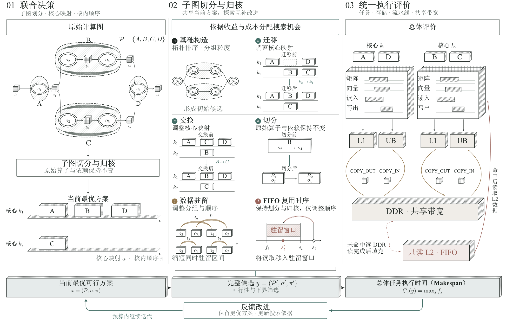
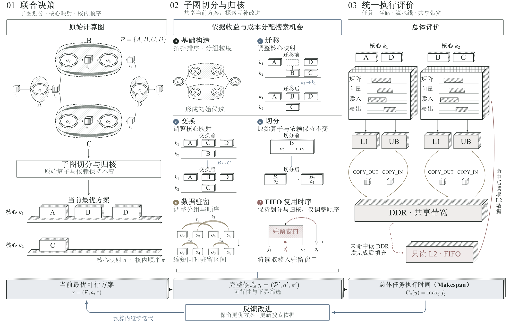
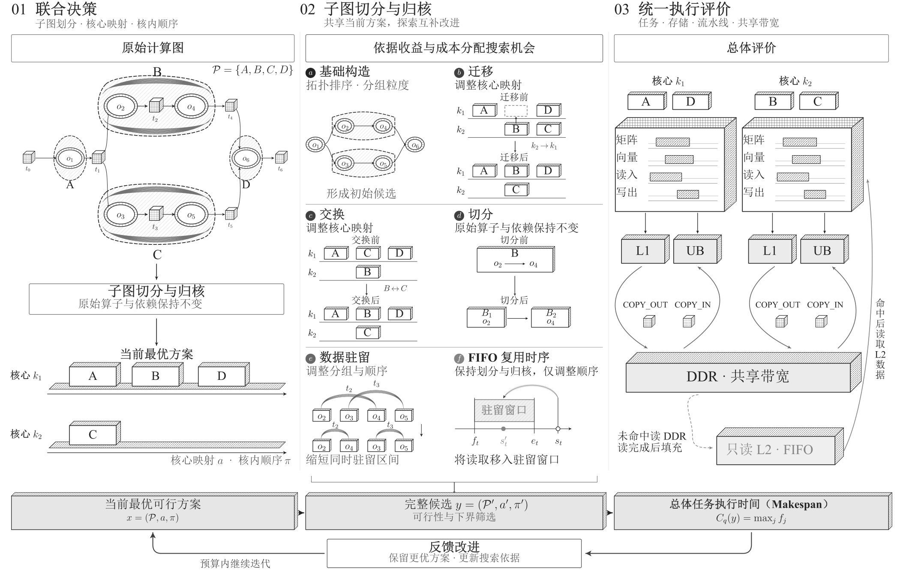

# 图1.1 · 第十三版（ink_v13）

基于 `ink_v11`，按最新确认将环节 02 改为**两列三排**：第一排 a／b，第二排 c／d，第三排 e／f。保留 01 联合决策 → 02 候选生成 → 03 统一执行评价与底部反馈闭环。四套配色采用相同布局和文字。

## 版式与文字

- 环节 02 为两列三排，列距 520、行距 500。六类操作汇入同一完整候选，保留交替搜索的含义。
- 整图画布为 3150×2000。相较本轮调整前的 3420×2000，横向收窄约 7.9%，纵向长度不变。
- 01、03 主体先统一等比放大 1.12 倍，再将 01 的 B/C 圈组、03 的管线框与存储模块分别等比增大，让图形占据周围空白。收紧模块间距并缩短连接箭头；不单独拉伸图形的横向或纵向。02 主要增大文字与字母，示意图保持原尺寸。
- 三栏顶部说明框和下方结果框分别齐平。迁移、交换与切分的前后标签及对应块对齐，03 两核的并列部件保持等高。
- 03 两个核心的流水线标签统一使用“矩阵、向量、读入、写出”。拉开操作标题与副标题、末行图形与说明的间距，重新排开文字与条形。
- 删除 02 顶部横框下的短箭头；e 的向下箭头移到上下两排块之间。保留 V11 的原生字形、斜线纹理、笔触和颜色，仅调整位置、等比大小及必要连接线。

字号是 SVG 用户单位，不能当作论文中的 pt。主图适合 `width=\textwidth`；另附 02 独立矢量图，可作为局部补图。图件按 A4 正文宽约 160 mm 提供排版样张。

## 四套配色

### 青绿·赭石

[矢量 PDF](exports/workflow_qinglu_v13.pdf) · [便携 SVG](assets/workflow_qinglu_v13.svg) · [可编辑 SVG](assets/workflow_qinglu_v13_editable.svg) · [高清 PNG](exports/workflow_qinglu_v13.png) · [02 局部 PDF](exports/workflow_qinglu_v13_detail.pdf)

### 浅绛·苔色

[矢量 PDF](exports/workflow_qianjiang_v13.pdf) · [便携 SVG](assets/workflow_qianjiang_v13.svg) · [可编辑 SVG](assets/workflow_qianjiang_v13_editable.svg) · [高清 PNG](exports/workflow_qianjiang_v13.png) · [02 局部 PDF](exports/workflow_qianjiang_v13_detail.pdf)

### 烟岚·石青

[矢量 PDF](exports/workflow_yanlan_v13.pdf) · [便携 SVG](assets/workflow_yanlan_v13.svg) · [可编辑 SVG](assets/workflow_yanlan_v13_editable.svg) · [高清 PNG](exports/workflow_yanlan_v13.png) · [02 局部 PDF](exports/workflow_yanlan_v13_detail.pdf)

### 墨线·灰阶

[矢量 PDF](exports/workflow_mono_v13.pdf) · [便携 SVG](assets/workflow_mono_v13.svg) · [可编辑 SVG](assets/workflow_mono_v13_editable.svg) · [高清 PNG](exports/workflow_mono_v13.png) · [02 局部 PDF](exports/workflow_mono_v13_detail.pdf)

主图 PDF 为 472.5×300 mm 的矢量母版，论文通过 `\includegraphics` 等比缩放；高清 PNG 宽 6000 像素，预览宽 2100 像素。局部 PDF 宽 150 mm，保留完整 02 和下方完整候选。便携 SVG、SVGZ 和 PDF 的文字已转曲；可编辑 SVG 保留 107 个文字对象，编辑时需要对应字体。交付不含字体文件。

## PR #69 配套正文

[一段式论文正文与插入说明](docs/PAPER_TEXT_PR69.md) · [可直接替换的 LaTeX 图文片段](docs/PR69_figure_and_text.tex) · [A4 排版样张](docs/workflow_qinglu_v13_A4.pdf)

PR #69 已合并，本次单独提交 v13 图件及配套文字。插入片段替换原 `fig:roadmap` 图环境和其后三段旧图说明，保留原标签。本次没有修改或重新编译原 80 页论文。

## 重建与核验

```bash
python -m pip install pymupdf pillow pypdf
# 安装 Inkscape；或将 INKSCAPE_BIN 指向便携版命令行程序。
python paper_a_figures/engraved_workflow/ink_v13/build.py --all
python paper_a_figures/engraved_workflow/ink_v13/verify.py --json paper_a_figures/engraved_workflow/ink_v13/docs/VERIFICATION.json
```

重建需要相邻的 `ink_v11/assets/` 八份原始 SVG。`build.py` 沿用已有原生字形；新增的八个流水线汉字使用与原图一致的宋体轮廓，保存在 `pipeline_glyphs.json`，重建无需下载字体。PDF 由 Inkscape 导出，PNG 由 MuPDF 独立渲染。核验包括两列三排的明确位置、四套配色的几何一致性、SVG 引用、SVGZ 内容、PDF 单页和无位图纹理、PNG 尺寸；同时查看整图及局部，不能以结构检查替代视觉审阅。

[实际检查记录](docs/LOCAL_REVIEW.md) · [自动核验](docs/VERIFICATION.json) · [四色总览](docs/four_palettes_review.png)
