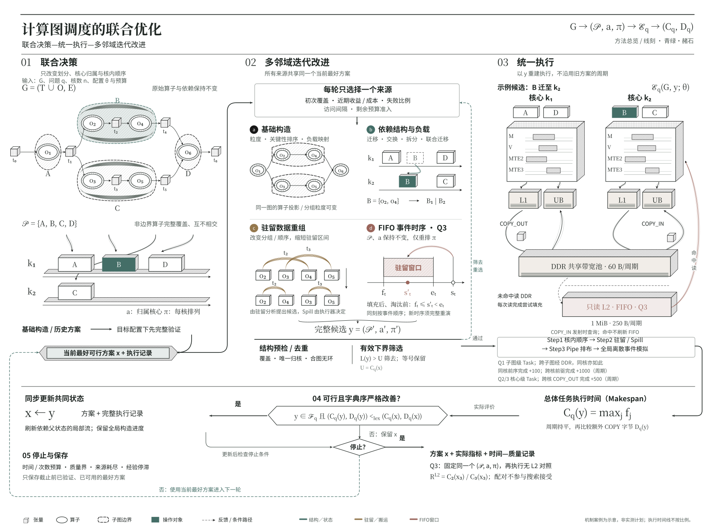

# 线刻设色总流程图 · 第二版

保留原 `engraved_workflow` 的六算子案例、子图包络、核心剖面、细排线与各方法模块；本轮重点改局部设色、跨模块连接和右下角公式留白。原母版、论文正文和其他论文图不覆盖。

这是当前流程图的主要展示、编辑和排版版本；第一版黑白 SVG 保留为生成器输入。返回 [图件总入口](../../README.md) 或 [流程图目录](../README.md)。

## 先看成图



默认配色：青绿·赭石。仓库同时提供普通 SVG 和 SVGZ 可编辑母版；另有浅绛、烟岚及灰阶。所有文字仍是 text/tspan，各模块、公式与流程连接都有独立 ID。SVG 中没有嵌入位图或字体文件。

`.svgz` 是同一 SVG 的无损压缩版本，Inkscape 可直接打开编辑。下表中的 PDF、高清 PNG 和预览已随交付包上传到仓库，可直接下载使用，也可用下面命令在本地重新导出。

| 配色 | 可编辑矢量母版 | 矢量 PDF | 高清 PNG | 预览 |
| --- | --- | --- | --- | --- |
| 青绿·赭石（默认） | [SVG](assets/workflow_qinglu.svg) / [SVGZ](assets/workflow_qinglu.svgz) | [PDF](exports/workflow_qinglu.pdf) | [PNG](exports/workflow_qinglu.png) | [预览](exports/workflow_qinglu_preview.png) |
| 浅绛·苔色 | [SVG](assets/workflow_qianjiang.svg) / [SVGZ](assets/workflow_qianjiang.svgz) | [PDF](exports/workflow_qianjiang.pdf) | [PNG](exports/workflow_qianjiang.png) | [预览](exports/workflow_qianjiang_preview.png) |
| 烟岚·石青 | [SVG](assets/workflow_yanlan.svg) / [SVGZ](assets/workflow_yanlan.svgz) | [PDF](exports/workflow_yanlan.pdf) | [PNG](exports/workflow_yanlan.png) | [预览](exports/workflow_yanlan_preview.png) |
| 灰阶 | [SVG](assets/workflow_mono.svg) / [SVGZ](assets/workflow_mono.svgz) | [PDF](exports/workflow_mono.pdf) | [PNG](exports/workflow_mono.png) | [预览](exports/workflow_mono_preview.png) |

主要连接现在只用单线：共同状态到来源选择、筛选通过到执行、执行到右侧评价、判断到更新、停止到输出。筛去重选和下一轮反馈各走独立通道。删除了原来包围公式的小弯箭头，Cq公式恢复为右侧评价区域的居中对象，箭头从区域右边进入，不穿过公式。

按 `workshop_v2` 明确一次小文字：每次读完成均尝试缓存填充，已驻留对象保持FIFO位置。其余方法名、符号、接受条件、三问执行参数和同方案配对含义不变。详见 `docs/SOURCE_ALIGNMENT.md`。

## 本地生成

仅生成可编辑SVG：

```bash
python paper_a_figures/engraved_workflow/ink_v2/build.py --all-palettes --svg-only
```

同时导出PDF、6000像素PNG和预览，需要本机Inkscape：

```bash
python paper_a_figures/engraved_workflow/ink_v2/build.py --all-palettes
```

可单独指定 `--palette qinglu`、`qianjiang`、`yanlan`、`mono`。颜色来自 `paper_a_figures/ink_engraving_agent/palettes.json`，构图与文字由本目录build.py读取旧母版后重组，始终以旧母版为输入，不读取自己上轮导出的文件。

画布420×310.8mm，额外高度只用于外侧回路与图例留白；三个上部模块的原坐标不改变。适合整页横向总图或数字放大阅读。后续小图应取相应局部模块，不能把所有细节压进半栏。

两条编辑路径：Inkscape手改SVG后另存；长期维护则改Python和角色色板再生成。重新生成会覆盖对应自动产物，不会覆盖另存的手工稿。

## 可持续图件Agent

`paper_a_figures/ink_engraving_agent/AGENT.md` 是完整操作提示词；`style.py` 能将同套风格赋予SVG及既有Matplotlib绘图代码，提供显式角色绑定、连续/发散色阶和保留文字的矢量导出。当前只交付总流程图与工具，不提前替换论文所有数据图。

[docs/REFERENCES.md](docs/REFERENCES.md) 记录新增国画设色来源。[原包制作记录](docs/LOCAL_REVIEW.md) 记录原制图环境的排版、绘制、渲染与视觉检查；[仓库整合记录](docs/BUNDLE_INTEGRATION.md) 记录本机导入与构建情况。图件采用程序化矢量制作，没有文生图、云端渲染或复制画作像素。
