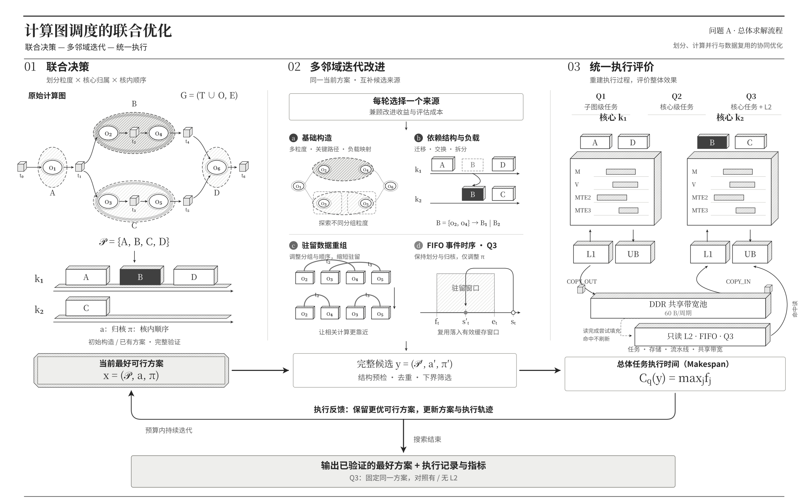

# 图 1.1 · 总体流程图第三版

**联合决策 → 多邻域候选 → 统一执行评价 → 反馈更新。**

延续第二版的线刻、排线、子图包络和处理器剖面风格，改用三个对齐模块、一条反馈回路和一个输出框。灰阶主版对应用户提供的截图；青绿为同构设色备选。



## 图件与独立说明

[灰阶可编辑 SVG](assets/workflow_v3_mono.svg) · [详细流程解释与图下注释](docs/FLOW_EXPLANATION.md) · [修订与检查记录](docs/REVISION_NOTES.md)

青绿设色版可用下方命令生成；本次对话的完整包已包含两套成图。

SVG 是独立矢量源文件，可在 Inkscape 中编辑文字、模块和箭头，不依赖旧版母图或外部图片。已生成的矢量 PDF、6000 像素 PNG、预览和完整制作包随本次对话提供；也可用下列命令从仓库源文件重新生成。

## 本地生成

仅生成 SVG，无第三方 Python 包依赖：

```bash
python paper_a_figures/engraved_workflow/ink_v3/build.py --all-palettes --svg-only
```

同时导出 PDF、高清 PNG 和预览，需要安装 Inkscape 并加入 PATH：

```bash
python paper_a_figures/engraved_workflow/ink_v3/build.py --all-palettes
```

默认灰阶，可用 `--palette qinglu` 选择设色版。中文推荐使用本机的 Noto Sans/Serif CJK SC，Windows 也提供 Microsoft YaHei 回退。不同字体可能改变文字宽度，重新导出后应检查排版；本次提供的 PDF 已嵌入所需字体子集。发行包不附带任何字体文件。

## 第三版的重点变化

保留六算子与 A/B/C/D 分组、核内排布、四类候选及统一执行硬件示意；删除图例、字典序判断和停止菱形；合并冗长的执行细则。跨模块连接只保留四条，图面突出方案、候选、执行与反馈，具体规则放进独立说明。

所有内容另存为第三版，不覆盖 `ink_v2`，不改论文和求解算法。来源基线为 `70d4888886cd9f77037f7b010ce0241349ef056d`，仅使用用户指定的第二版图稿和 `workshop_v2`；没有参考 PR #57。

仓库展示 SVG 采用紧凑序列化，主要模块与连接 ID 保留；生成脚本输出带完整对象 ID 的排版文本，两者构图相同。已在本机以 1800 像素导出比较，像素一致。
