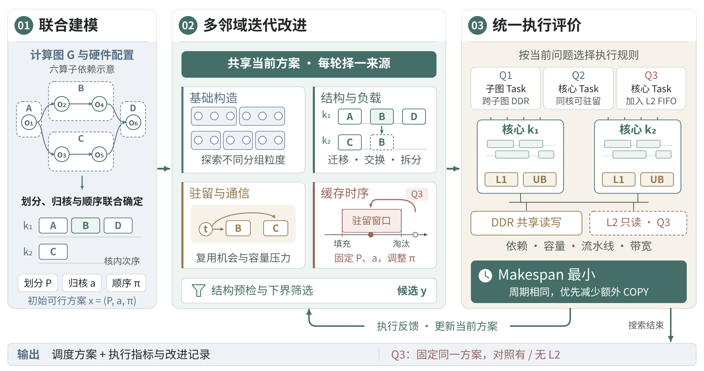

# 总体流程图 · 第三版

基于 `ink_v2` 重组的**建模思想版**，用于替换论文图1.1的候选图稿。本目录独立保存第三版，不覆盖第二版，也不修改论文或实验数据。



## 文件

| 用途 | 文件 |
|---|---|
| 论文用矢量PDF | [workflow_v3.pdf](exports/workflow_v3.pdf) |
| 高清PNG | [workflow_v3.png](exports/workflow_v3.png) |
| 快速预览 | [workflow_v3_preview.png](exports/workflow_v3_preview.png) |
| 可编辑SVG，文字仍是文本 | [workflow_v3.svg](assets/workflow_v3.svg) |
| 文字转路径SVG，跨设备显示稳定 | [workflow_v3_outlined.svg](exports/workflow_v3_outlined.svg) |
| 独立的详细解释 | [流程图详细说明](docs/流程图详细说明.md) |
| 绘制与导出脚本 | [build.py](build.py) |

画布180×95mm；高清PNG为4252×2244像素，约600dpi。图内不重复印正式图号与图题，后续交由论文排版统一编号。SVG和PDF均以矢量图元为主体，PDF文字转路径，没有将PNG套入PDF。

## 相对第二版

用三个大区和一个输出带组织“联合建模—多邻域改进—执行评价—方案输出”。跨模块只留两条向前连接、一条反馈回路和一条输出连接，共四条；局部图元中的依赖箭头和移动箭头不在此计数中。

删去底部图例、04接受判断、停止菱形、Step1/Step2/Step3、同步周期常数及细碎跳转。目标仍在评价区明示，算法条件保留在独立解释与正文。四类来源并排表示每轮可选项，Q3标记限定缓存时序来源；三问是执行场景，不是连续阶段。

沿用第二版青绿、赭石、淡朱与石青色系，改用浅色分区、统一字号和短标签；保留六算子分组、核心序列、迁移、张量复用和驻留窗口等有信息量的图元。没有嵌入参考图片或字体文件。

## 重新生成

需要Python 3.10+、Inkscape和本机可用的Noto Sans CJK SC（或兼容中文字体）。

```bash
python paper_a_figures/engraved_workflow/ink_v3/build.py
```

只生成可编辑SVG：

```bash
python paper_a_figures/engraved_workflow/ink_v3/build.py --svg-only
```

重新运行会覆盖本目录自动生成的同名文件；手工编辑SVG后请另存，不要再用生成脚本覆盖手工稿。字体只在本机/构建环境解析，不随图件分发。

## 语义与检查

当前方法基线为 `6e7fd0f6e4d06b0b2846d4d8bc29a783857eb930`。详见[独立说明](docs/流程图详细说明.md)与[复核记录](docs/REVIEW.md)。示意图不承载新实验结果，原始数据、算法、论文与第二版均未改动。
