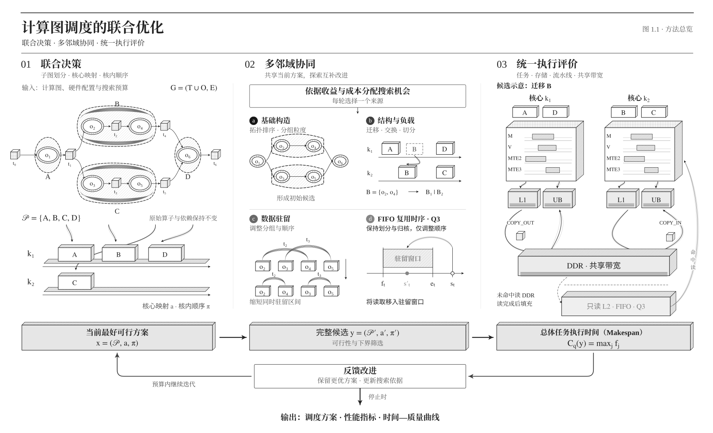

# 图1.1 · 线刻流程图第三版

以指定的 `ink_v2` 为唯一图形母版，保留六算子案例、子图包络、核心任务条、硬件剖面和排线质感；重新组织为“联合决策—多邻域协同—统一执行评价”，下方以单一反馈回路连接。第二版、论文正文和实验数据均保持原样。

## 成图



| 版本 | 可编辑SVG | 压缩SVG | 矢量PDF | 6000像素PNG | 预览 |
|---|---|---|---|---|---|
| 灰阶，与用户截图一致 | [SVG](assets/workflow_mono_v3.svg) | [SVGZ](assets/workflow_mono_v3.svgz) | [PDF](exports/workflow_mono_v3.pdf) | [PNG](exports/workflow_mono_v3.png) | [预览](exports/workflow_mono_v3_preview.png) |
| 青绿·赭石，沿用第二版设色 | [SVG](assets/workflow_qinglu_v3.svg) | [SVGZ](assets/workflow_qinglu_v3.svgz) | [PDF](exports/workflow_qinglu_v3.pdf) | [PNG](exports/workflow_qinglu_v3.png) | [预览](exports/workflow_qinglu_v3_preview.png) |

详细解释与图分开保存：[FIGURE_EXPLANATION.md](docs/FIGURE_EXPLANATION.md)。其中包含建议图注、可放在图后的正文段落，以及逐模块的完整说明。

## 本版变化

- 三个主模块的结果沿同一水平线排列，模块间主箭头减为两条；反馈连接保持单一回路，另设停止输出分支。
- 删除底部全部图例，删除原04字典序判断与停止菱形，改为“保留更优方案、更新搜索依据”的概念说明。
- 删除Step1/2/3、具体等待周期和硬件数值等过细文字；保留统一执行模型和主要目标。
- 原始案例、四类候选插图、两核剖面及L2窗口继续使用第二版矢量，不以简单方框替代。
- A、B、C、D统一为同一种纸面样式。旧稿中B的深色只用于提示“迁移B”，不代表不同类型；第三版改由迁移箭头和“迁移 B”短语表达，避免把颜色误读为额外语义。
- 删除输出区“Q3：固定同一方案……”一行；同方案有无L2配对仍在独立图解和论文正文中说明。
- 修正 `G=(T\cup O,E)`、核心下标、`COPY_IN`、`COPY_OUT` 和Makespan公式的位置与基线。
- 灰阶和青绿版本布局与文字完全一致；图示不增加算法机制或实验成绩。

## 字体与公式

图中文字与 `workshop_v2` 论文采用同一类排版体系：西文优先 Times New Roman（Linux导出使用等宽兼容的 Liberation Serif），中文优先宋体/宋体兼容字体，数学符号优先 STIX Math。`𝒫`、核心下标及Makespan公式均使用数学字体和真实下标，不再依赖普通中文字体中的替代字形。

SVG保留可编辑文字；PDF导出时将文字转换为矢量轮廓，因此不随查看机器的字体安装情况漂移。仓库不附带字体文件。

## 编辑与导出

依赖Python 3.10+及Inkscape。在仓库根目录执行：

```bash
python paper_a_figures/engraved_workflow/ink_v3/build.py
```

默认读取相邻 `ink_v2/assets/` 中的灰阶和青绿SVG，生成本目录的SVG、SVGZ、PDF、6000像素PNG及1800像素预览。仅生成矢量源码可加 `--svg-only`；重建其他第二版配色可使用 `--palettes qianjiang yanlan`。可用 `--out <新目录>` 保留已有手改稿。

画布为420×255.5mm，适合论文横向整页或宽幅展示；需要缩小排版时优先采用矢量PDF。流程图解释、版本来源和视觉检查分别位于 `docs/`，不混入论文图像。

本次源版本：`70d4888886cd9f77037f7b010ce0241349ef056d` 的 `paper_a_figures/engraved_workflow/ink_v2/`。没有读取或参考PR #57。
