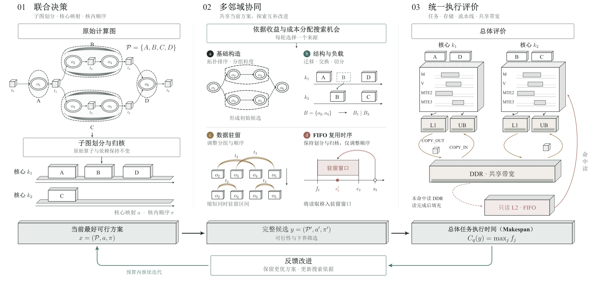
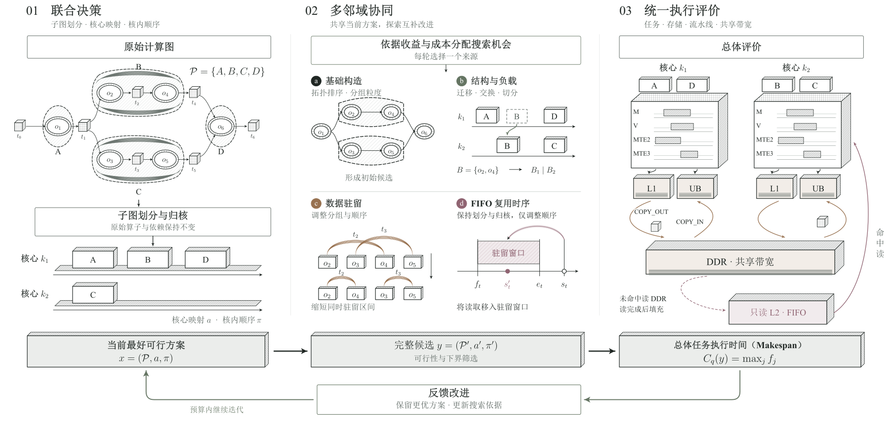
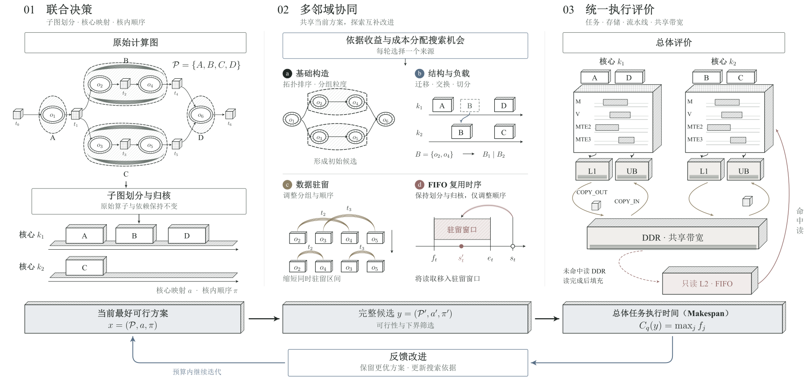
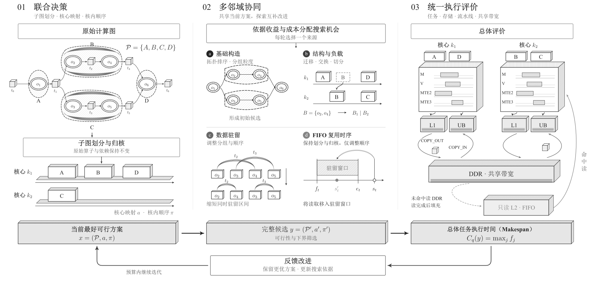

# 图1.1 · 第四版（14条原始批注）

第四版以已合并的 `ink_v3` 实际矢量为底稿，落实 `Figure_1_1_v4_14_annotations.zip` 中的14条批注。只使用用户指定的 `ink_v2/assets` 所对应四套既有配色；没有新增配色、算法、实验数字，也没有使用生图服务。

## 四套完整结果

|配色|可改文字的SVG|跨电脑稳定显示的转曲SVG|矢量PDF|6000像素PNG|
|---|---|---|---|---|
|青绿·赭石|[编辑](assets/workflow_qinglu_v4_editable.svg)|[查看](assets/workflow_qinglu_v4.svg)|[PDF](exports/workflow_qinglu_v4.pdf)|[PNG](exports/workflow_qinglu_v4.png)|
|浅绛·苔色|[编辑](assets/workflow_qianjiang_v4_editable.svg)|[查看](assets/workflow_qianjiang_v4.svg)|[PDF](exports/workflow_qianjiang_v4.pdf)|[PNG](exports/workflow_qianjiang_v4.png)|
|烟岚·石青|[编辑](assets/workflow_yanlan_v4_editable.svg)|[查看](assets/workflow_yanlan_v4.svg)|[PDF](exports/workflow_yanlan_v4.pdf)|[PNG](exports/workflow_yanlan_v4.png)|
|墨线·灰阶|[编辑](assets/workflow_mono_v4_editable.svg)|[查看](assets/workflow_mono_v4.svg)|[PDF](exports/workflow_mono_v4.pdf)|[PNG](exports/workflow_mono_v4.png)|

### 青绿·赭石


### 浅绛·苔色


### 烟岚·石青


### 墨线·灰阶


## 14条批注的主要变化

顶部总标题与图号栏、底部停止/输出区域已删除；反馈改进与迭代回路保留。左列形成“原始计算图 → 子图划分与归核 → 核心布局”，划分集合公式移入上方图的右上留白，原图定义公式删除。左列核心标签补全。

右列新增总体评价框；B迁移改为单条顺滑曲线；左侧两条搬运箭头分别标注COPY_OUT、COPY_IN，右侧重复COPY_IN删除，箭头头部不再被DDR顶面挡住。L2从457缩至330个SVG单位，移除两个指定Q3标记与横向虚线，扩大填充虚线弧度，放大“命中读”。逐条原文、处理和对象位置见 [ANNOTATIONS_APPLIED.md](docs/ANNOTATIONS_APPLIED.md)。前几轮问题及本轮解决方法见 [PROCESS_ISSUES.md](docs/PROCESS_ISSUES.md)。

## 可编辑与字体

`*_editable.svg` 保留82个真实文字对象；数学公式保持第三版Computer Modern矢量及`data-tex`。`*.svg`与PDF中的文字是原稿SimSun/Times New Roman字形轮廓，用于跨电脑稳定显示，不能把转曲版当成直接打字可改的文本版。

新中文标题只重新组合原矢量里已经存在的字形。原公式路径不变。没有复制或附带字体文件。文字编辑在本机使用论文对应字体；公式内容修改可沿用第三版数学排版脚本。本次不自动替换论文正文中的插图。

## 重建

在仓库根目录：

```bash
python paper_a_figures/engraved_workflow/ink_v4/build.py --all --png-width 6000
python paper_a_figures/engraved_workflow/ink_v4/verify.py
```

单独导出可用 `--palette qinglu`，仅写SVG可用`--svg-only`。标准库完成矢量修改；PDF/PNG导出使用本机Inkscape。输入是 `ink_v3/assets/workflow_mono_v3(_editable).svg`，配色唯一来源是`paper_a_figures/ink_engraving_agent/palettes.json`。

尺寸420×200.2mm；缩放时保持纵横比。每套提供SVG、SVGZ、编辑SVG、PDF、高清PNG、预览PNG。所有版本的文字和几何相同，只替换既有主题颜色。
