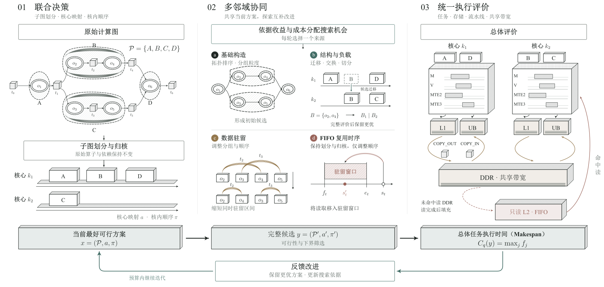
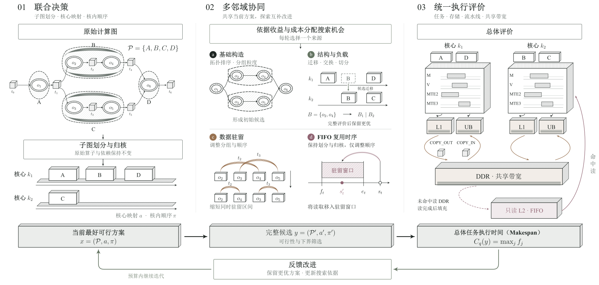
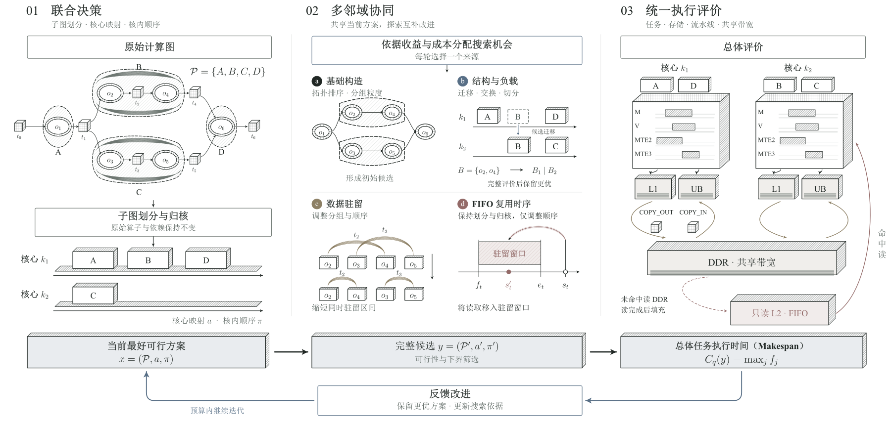
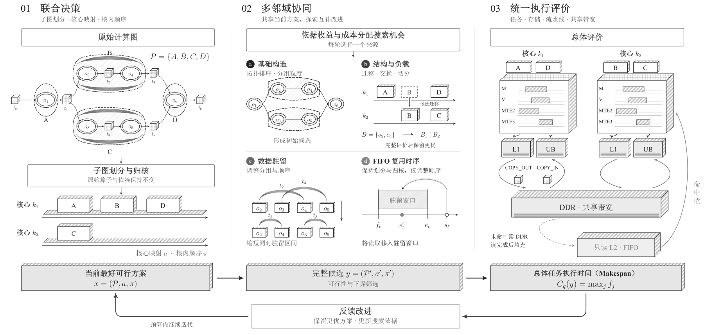
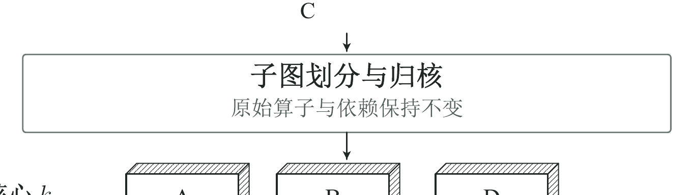
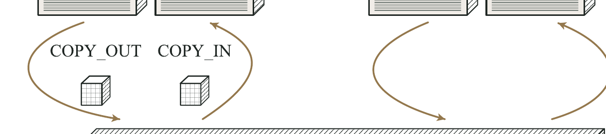
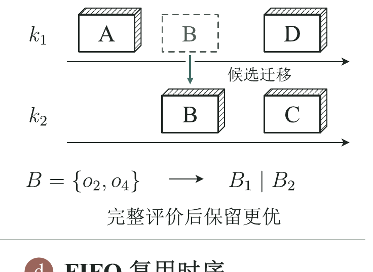

# 图1.1 · 第五版

在第四版原矢量上落实本轮四项要求。四套配色的几何、文字与公式完全一致；不改动第四版、论文正文、算法或实验数据。

## 四套完整图件

|配色|可编辑SVG|转曲SVG|矢量PDF|高清PNG|
|---|---|---|---|---|
|青绿·赭石|[编辑](assets/workflow_qinglu_v5_editable.svg)|[查看](assets/workflow_qinglu_v5.svg)|[PDF](exports/workflow_qinglu_v5.pdf)|[PNG](exports/workflow_qinglu_v5.png)|
|浅绛·苔色|[编辑](assets/workflow_qianjiang_v5_editable.svg)|[查看](assets/workflow_qianjiang_v5.svg)|[PDF](exports/workflow_qianjiang_v5.pdf)|[PNG](exports/workflow_qianjiang_v5.png)|
|烟岚·石青|[编辑](assets/workflow_yanlan_v5_editable.svg)|[查看](assets/workflow_yanlan_v5.svg)|[PDF](exports/workflow_yanlan_v5.pdf)|[PNG](exports/workflow_yanlan_v5.png)|
|墨线·灰阶|[编辑](assets/workflow_mono_v5_editable.svg)|[查看](assets/workflow_mono_v5.svg)|[PDF](exports/workflow_mono_v5.pdf)|[PNG](exports/workflow_mono_v5.png)|

### 青绿·赭石

### 浅绛·苔色

### 烟岚·石青

### 墨线·灰阶


## 本轮修改

1. “子图划分与归核”框的上下箭头共用框中心线 x=516。
2. 原来右侧的小立方体移到左侧 COPY_IN 下方。COPY_OUT 与 COPY_IN 两组文字共用基线，两个立方体等尺寸并以视觉中心对齐各自文字；分别对应出核至DDR、DDR入核的弧线，搬运方向不变。
3. 下方B与上方虚线B对齐，迁移箭头改成直线和对称三角箭头。箭杆止于箭头底部，不再穿出尖端；与时间轴交叉处留缝，避免误读成连接节点。
4. 按论文与代码澄清：B迁移只是候选，不是已证明的最优解。新增“候选迁移”“完整评价后保留更优”，保留迁移、交换、切分等候选及完整评价反馈回路，不虚构一个所谓最优排布。

### 三处局部放大（从PDF独立渲染）




## 为什么不直接画成“B移到k2就是最优”

第二问的完整方案同时包含划分、归核和核内顺序。迁移可能减少跨核交接，也可能损失并行性、延长驻留或增加换出；最终依据完整执行所得的 `(C₂,D₂)` 字典序判定：先比较总体执行时间，持平时比较额外COPY字节，且必须可行。

原图没有给出足以确定最优解的具体算子耗时、张量字节和硬件配置，也没有这张示意图的最优性证书。因此，第五版表达的是**实际方法如何产生并选取更优可行方案**，而不是替某个B摆放位置背书。详见 [建模依据](docs/MODEL_ALIGNMENT.md)。

## 格式与复现

尺寸420×200.2 mm；高清PNG为6000×2860，预览为1800×858。每套均另有SVGZ。编辑版保留84个文字对象；转曲SVG/PDF复用原SimSun、Times New Roman字形与48组Computer Modern数学对象。新增中文也从原图已有字形组合，不附带字体文件。

在仓库根目录运行（Python标准库、Inkscape和Poppler工具）：

```bash
python paper_a_figures/engraved_workflow/ink_v5/build.py --all
python paper_a_figures/engraved_workflow/ink_v5/verify.py --renders
```

仅生成SVG可用 `--svg-only`。输入严格检查第四版8个SVG的Git blob哈希。对象核验见 [OBJECT_REVIEW.json](docs/OBJECT_REVIEW.json)，本地审图说明见 [LOCAL_REVIEW.md](docs/LOCAL_REVIEW.md)。
