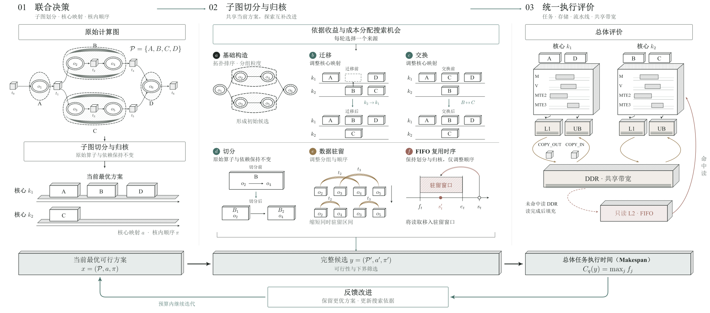
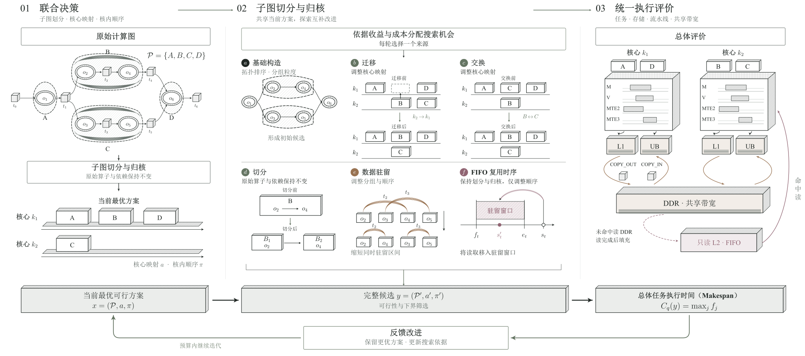
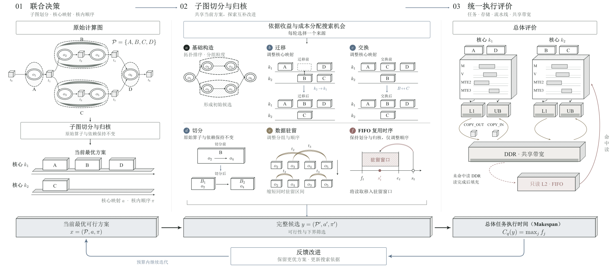
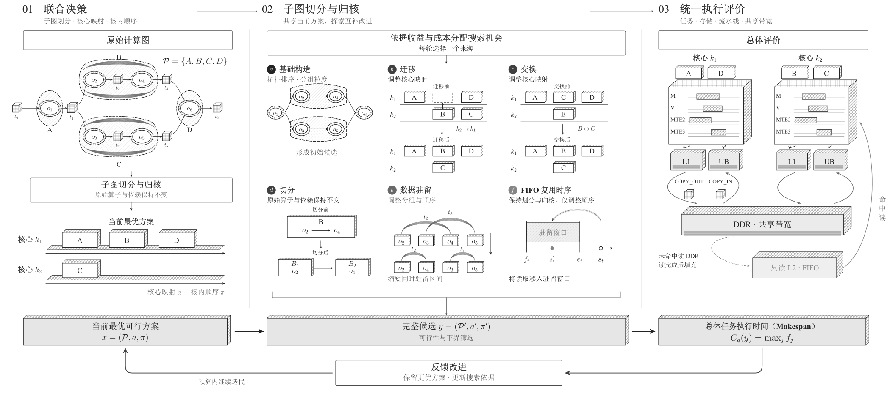

# 图1.1 · 第六版（ink_v6）

本版从已发布 `ink_v5` 的四套SVG母版作确定性矢量修改。只新增本目录，保留第五版、已合并PR #69的现稿、求解算法及实验数据。

## 修改

01、02、03由显式方向箭头连接，候选汇入完整评价，再由同一反馈回路更新当前最优可行方案。02改为“子图切分与归核”，与01中的同名步骤相对应。02工作区由910扩至1410个坐标单位，采用三列两行，不压缩01原始计算图或03处理器剖面。

- a 基础构造：保留原六算子依赖图与分组示意。
- b 迁移：`k1: AD / k2: BC` → `k1: ABD / k2: C`，并明确画出B从k2上移至k1；虚线空框只表示目标位置。
- c 交换：`k1: ACD / k2: B` → `k1: ABD / k2: C`，B与C互换归核。
- d 切分：`B={o2,o4}` → `B1={o2}, B2={o4}`，保留 `o2→o4` 依赖，既非复制B也非删除依赖。
- e、f分别沿用原c的数据驻留图与原d的FIFO复用时序图，仅调整编号和位置。

01最后的核上排布明确标为“当前最优方案”。这里的最优限于已评价候选，不是全局最优证明。题目范围**仅在配套正文中写明：问题一a–d，问题二a–e，问题三a–f**，不在图内添加问题编号。

六幅子图展开的是操作，不意味着将程序的四类候选来源改成六个：b/c/d仍属于结构与负载来源。本次没有更改预算控制器。

## 四套配色与文件

### 青绿·赭石

[矢量PDF](exports/workflow_qinglu_v6.pdf) · [便携SVG](assets/workflow_qinglu_v6.svg) · [可编辑SVG](assets/workflow_qinglu_v6_editable.svg) · [高清PNG](exports/workflow_qinglu_v6.png)

### 浅绛·苔色

[矢量PDF](exports/workflow_qianjiang_v6.pdf) · [便携SVG](assets/workflow_qianjiang_v6.svg) · [可编辑SVG](assets/workflow_qianjiang_v6_editable.svg) · [高清PNG](exports/workflow_qianjiang_v6.png)

### 烟岚·石青

[矢量PDF](exports/workflow_yanlan_v6.pdf) · [便携SVG](assets/workflow_yanlan_v6.svg) · [可编辑SVG](assets/workflow_yanlan_v6_editable.svg) · [高清PNG](exports/workflow_yanlan_v6.png)

### 墨线·灰阶

[矢量PDF](exports/workflow_mono_v6.pdf) · [便携SVG](assets/workflow_mono_v6.svg) · [可编辑SVG](assets/workflow_mono_v6_editable.svg) · [高清PNG](exports/workflow_mono_v6.png)

每套还提供压缩便携SVGZ。PNG为6000×2657，预览为2100×930。SVG画布3500×1550，PDF物理尺寸490×217毫米，可由LaTeX按正文宽度等比插入。

## 直接插入PR #69对应论文的正文

- [正文、图注与插入位置（Markdown）](docs/PAPER_TEXT_PR69.md)
- [保留fig:roadmap标签的LaTeX替换片段](docs/PR69_figure_and_text.tex)

PR #69已合并；说明按其合并提交`5fa0da91962968f02c18264b5d502c11ec2e538f`核对。替换第一章的原图环境及其后两段，不要重复添加同名标签。本次并未直接修改或重新编译整篇论文。

## 字体与重建

便携SVG及PDF复用v5中的SimSun、Times New Roman字形轮廓；数学内容保留原有Computer Modern，新添数学标记也采用Computer Modern。可编辑SVG保留101个文字对象，机器上需有相应字体才能原样编辑。交付内容不含任何字体文件；便携SVG和PDF没有字体依赖，也没有位图拼接。

```bash
python -m pip install matplotlib==3.10.8 pymupdf pillow
# 系统还需安装 Inkscape、Poppler（pdfinfo/pdffonts/pdfimages）
python paper_a_figures/engraved_workflow/ink_v6/build.py --all
python paper_a_figures/engraved_workflow/ink_v6/verify.py
python paper_a_figures/engraved_workflow/ink_v6/review.py
```

`build.py`只写v6并核验v5的Git blob哈希；缺少母版或源文件发生变化时会停止。`verify.py`核对迁移/交换前后分配、切分依赖、所有连接与SVG引用、四配色几何一致性、01计算图与03完整原图保留、COPY标注配对，以及四份单页PDF无字体/位图资源。审图记录见[LOCAL_REVIEW.md](docs/LOCAL_REVIEW.md)，自动检查见[OBJECT_REVIEW.json](docs/OBJECT_REVIEW.json)。
