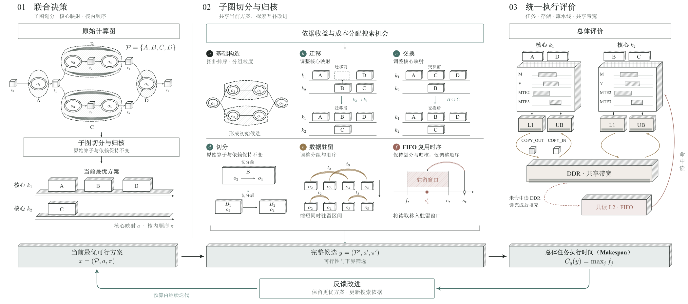
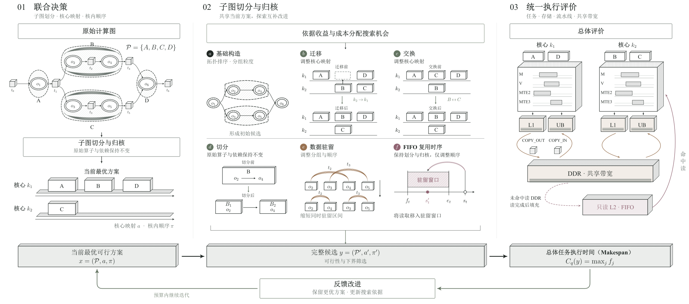
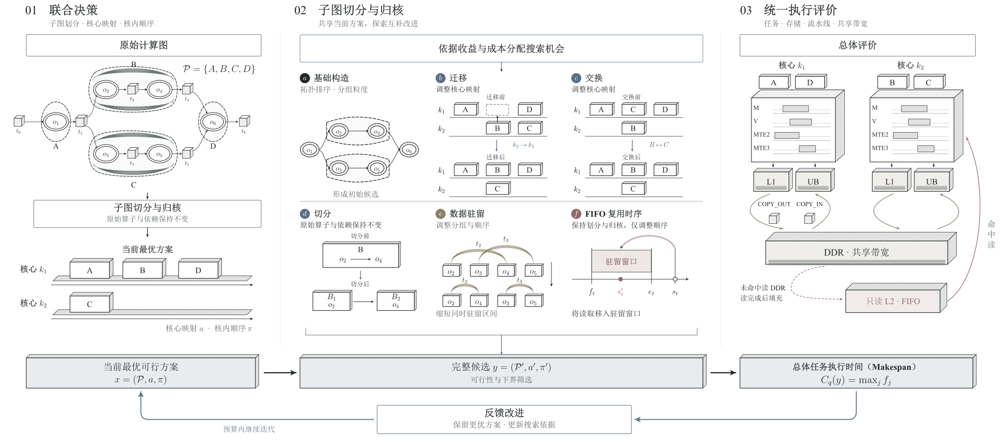
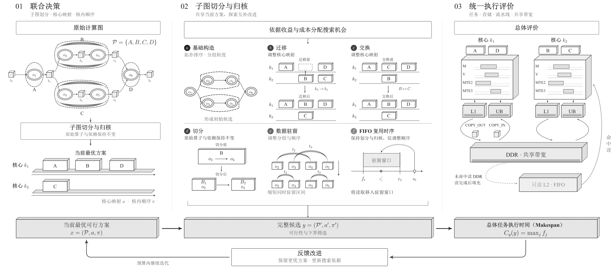

# 图1.1 · 第七版（ink_v7）

基于已发布第六版的四套SVG源文件，仅落实本轮五项修改。只新增本目录；不覆盖v6、已合并PR #69的论文、求解代码或实验数据。

## 五项修改

1. 删除顶部01→02和02→03的两条箭头；底部候选—评价—反馈闭环保留。
2. a的标题与副标题保持原位，只把图形及“形成初始候选”整体下移80.5个SVG单位。原算子图中心y=679，调整后为759.5，与b/c前后状态图的整体几何中心对齐。不缩放或变形。
3. 删除“每轮选择一个来源”，并把剩余的“依据收益与成本分配搜索机会”在原框内垂直居中。
4. 四条核心至L1/UB的短曲线改为同规格竖直向下箭头，使用独立的固定尺寸箭头头部，保持与上下物体的间距。
5. DDR未命中后填充L2的虚线弧线向说明文字靠拢，最近处保留约20个SVG单位的空隙；起点、终点、方向、颜色和虚线样式保持不变。

## 四套配色

### 青绿·赭石

[矢量PDF](exports/workflow_qinglu_v7.pdf) · [便携SVG](assets/workflow_qinglu_v7.svg) · [可编辑SVG](assets/workflow_qinglu_v7_editable.svg) · [压缩SVGZ](assets/workflow_qinglu_v7.svgz) · [高清PNG](exports/workflow_qinglu_v7.png)

### 浅绛·苔色

[矢量PDF](exports/workflow_qianjiang_v7.pdf) · [便携SVG](assets/workflow_qianjiang_v7.svg) · [可编辑SVG](assets/workflow_qianjiang_v7_editable.svg) · [压缩SVGZ](assets/workflow_qianjiang_v7.svgz) · [高清PNG](exports/workflow_qianjiang_v7.png)

### 烟岚·石青

[矢量PDF](exports/workflow_yanlan_v7.pdf) · [便携SVG](assets/workflow_yanlan_v7.svg) · [可编辑SVG](assets/workflow_yanlan_v7_editable.svg) · [压缩SVGZ](assets/workflow_yanlan_v7.svgz) · [高清PNG](exports/workflow_yanlan_v7.png)

### 墨线·灰阶

[矢量PDF](exports/workflow_mono_v7.pdf) · [便携SVG](assets/workflow_mono_v7.svg) · [可编辑SVG](assets/workflow_mono_v7_editable.svg) · [压缩SVGZ](assets/workflow_mono_v7.svgz) · [高清PNG](exports/workflow_mono_v7.png)

四种配色的几何与文字完全一致，仅颜色不同。SVG画布为3500×1550；PDF物理尺寸为490×217毫米；高清PNG为6000×2657，预览为2100×930。四份PDF均为纯矢量单页，没有位图拼接。

## 论文配套文字

[可直接使用的正文、图注与插入说明](docs/PAPER_TEXT_PR69.md) · [保留fig:roadmap的LaTeX替换片段](docs/PR69_figure_and_text.tex)

文本已对应a—f六种操作及三个问题的使用范围。PR #69已经合并，本次提供图文替换材料，没有直接更新或重新编译80页论文。

## 字体与可编辑性

便携SVG与PDF沿用v6的SimSun、Times New Roman及Computer Modern字形轮廓，不依赖查看设备安装相应字体。可编辑SVG保留100个文字对象，编辑时需要原有字体。交付不含任何字体文件，也没有重新生成或替换字形。为最小化修改，继承对象保留原SVG内部ID。

## 重建与核验

```bash
python -m pip install pymupdf pillow
# 系统安装Inkscape
python paper_a_figures/engraved_workflow/ink_v7/build.py --all
python paper_a_figures/engraved_workflow/ink_v7/verify.py
python paper_a_figures/engraved_workflow/ink_v7/review.py
```

构建前核验全部八份v6 SVG的Git blob哈希。`verify.py`反向撤销五项改动后逐对象对比v6，确认没有额外几何、文字、字体或科学内容变化；同时核对配色一致性、SVG引用、图形位置和纯矢量导出。`review.py`使用独立MuPDF渲染PDF，输出整图拼版与关键部位放大图。

[本地审阅记录](docs/LOCAL_REVIEW.md) · [自动核验结果](docs/OBJECT_REVIEW.json) · [四配色拼版](docs/four_palettes_review.png) · [a/b/c对齐](docs/detail_02_alignment.png) · [四个箭头](docs/detail_03_arrows.png) · [L2虚线](docs/detail_l2_fill.png)
