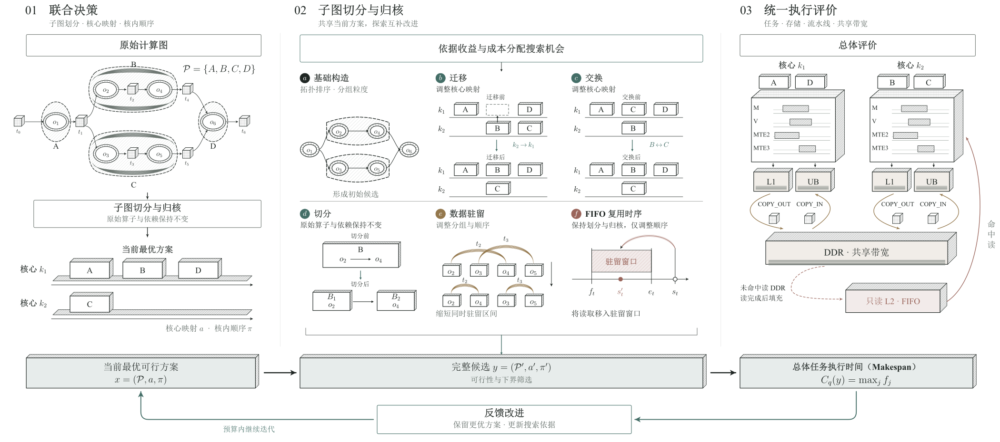
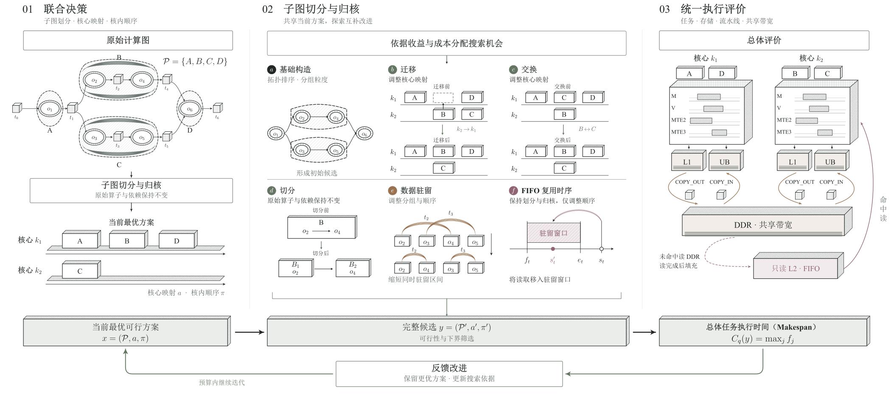
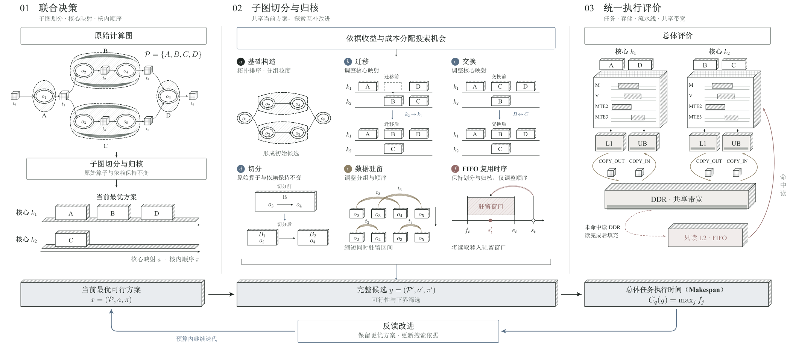
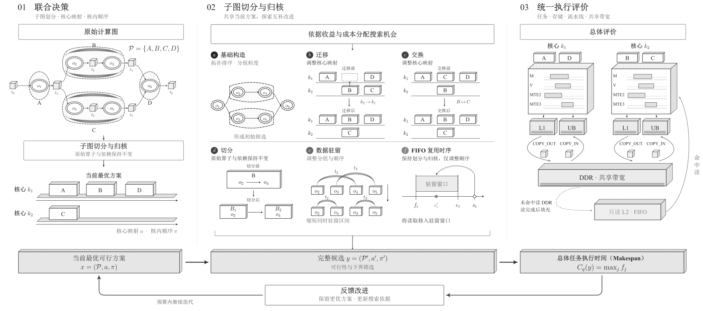

# 图1.1 · 第八版（ink_v8）

基于已发布第七版，仅补齐右侧核心与DDR之间的COPY标注。只新增本目录，不覆盖前版、已合并PR #69的论文、求解代码或实验数据。

## 本轮唯一图形修改

在右侧既有的两个搬运箭头处，分别添加 **COPY_OUT＋小立方体** 和 **COPY_IN＋小立方体**。直接复制左侧原字形与立方体，整体水平平移432个SVG单位；不缩放、不重新排版、不改动箭头。左右文字保持同一高度，四个立方体保持同一尺寸与高度。

全部原有对象、文字、数学记号、连线、箭头、布局和配色均保持不变。第七版已完成的五处修改完整保留。

## 四套配色

### 青绿·赭石

[矢量PDF](exports/workflow_qinglu_v8.pdf) · [便携SVG](assets/workflow_qinglu_v8.svg) · [可编辑SVG](assets/workflow_qinglu_v8_editable.svg) · [SVGZ](assets/workflow_qinglu_v8.svgz) · [高清PNG](exports/workflow_qinglu_v8.png)

### 浅绛·苔色

[矢量PDF](exports/workflow_qianjiang_v8.pdf) · [便携SVG](assets/workflow_qianjiang_v8.svg) · [可编辑SVG](assets/workflow_qianjiang_v8_editable.svg) · [SVGZ](assets/workflow_qianjiang_v8.svgz) · [高清PNG](exports/workflow_qianjiang_v8.png)

### 烟岚·石青

[矢量PDF](exports/workflow_yanlan_v8.pdf) · [便携SVG](assets/workflow_yanlan_v8.svg) · [可编辑SVG](assets/workflow_yanlan_v8_editable.svg) · [SVGZ](assets/workflow_yanlan_v8.svgz) · [高清PNG](exports/workflow_yanlan_v8.png)

### 墨线·灰阶

[矢量PDF](exports/workflow_mono_v8.pdf) · [便携SVG](assets/workflow_mono_v8.svg) · [可编辑SVG](assets/workflow_mono_v8_editable.svg) · [SVGZ](assets/workflow_mono_v8.svgz) · [高清PNG](exports/workflow_mono_v8.png)

四种配色仅颜色不同，几何与文字一致。SVG画布3500×1550；PDF物理尺寸490×217毫米；高清PNG为6000×2657，预览为2100×930。每份PDF均为单页纯矢量图。

## PR #69 论文配套文字

[可直接使用的正文、图注与插入说明](docs/PAPER_TEXT_PR69.md) · [保留fig:roadmap的LaTeX替换片段](docs/PR69_figure_and_text.tex)

替换已合并PR #69现稿第一章的原图环境及其后两段说明，避免重复添加`fig:roadmap`。LaTeX片段已指向第八版青绿PDF；正文说明a—f操作、三问使用范围、统一评价与反馈，以及两核COPY标注、DDR和只读L2的含义。COPY_OUT仍写往DDR；第三问COPY_IN在发射时选择L2/DDR路径，在完成时按容量及FIFO规则尝试填充。

本次交付可插入材料，没有直接更新或重新编译80页论文。

## 字体与可编辑性

便携SVG和PDF沿用第七版SimSun、Times New Roman及Computer Modern字形轮廓。新增COPY文字也是原字形的直接复制，不依赖接收设备安装字体。可编辑SVG各有102个文字对象，编辑时需要原有字体。交付不包含任何字体文件。

## 重建与核验

```bash
python -m pip install pymupdf pillow
# 系统安装Inkscape
python paper_a_figures/engraved_workflow/ink_v8/build.py --all
python paper_a_figures/engraved_workflow/ink_v8/verify.py
python paper_a_figures/engraved_workflow/ink_v8/pixel_check.py
python paper_a_figures/engraved_workflow/ink_v8/review.py
```

构建核对全部八份第七版SVG的Git blob值。`verify.py`删除新增标注并恢复版本元数据后，要求整份XML序列化结果与第七版完全一致，另查验四个复制对象、箭头与关联、配色一致性及矢量导出。`pixel_check.py`以同一Inkscape渲染两版，要求新增标注区域之外的变化像素数为0。`review.py`用独立MuPDF渲染全部PDF及局部图。

[本地审阅记录](docs/LOCAL_REVIEW.md) · [对象核验](docs/OBJECT_REVIEW.json) · [像素核验](docs/PIXEL_REVIEW.json) · [四色整图](docs/four_palettes_review.png) · [四色COPY细节](docs/four_palettes_copy_detail.png) · [青绿COPY放大图](docs/detail_copy_pairs.png)
