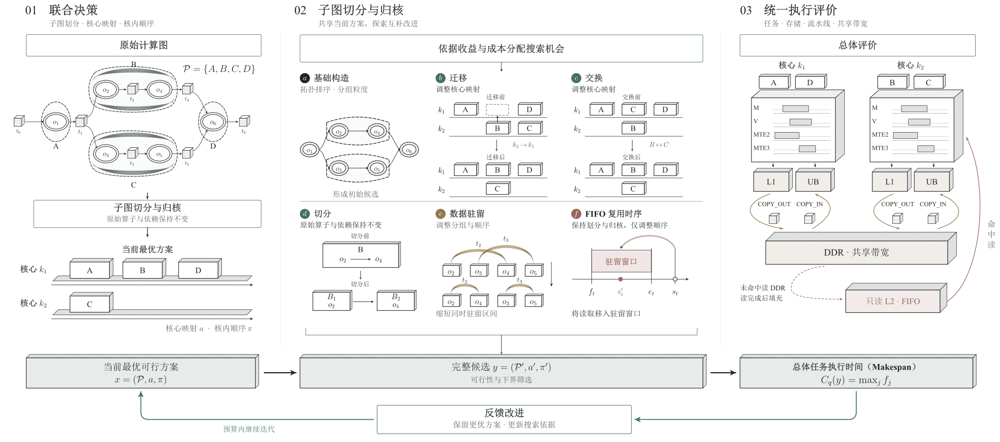
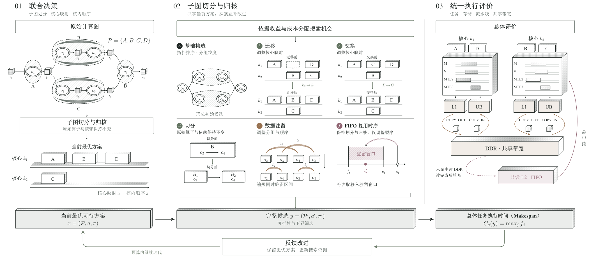
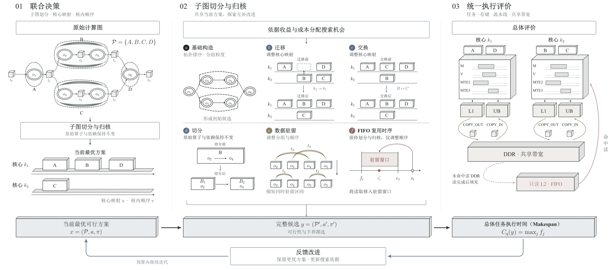
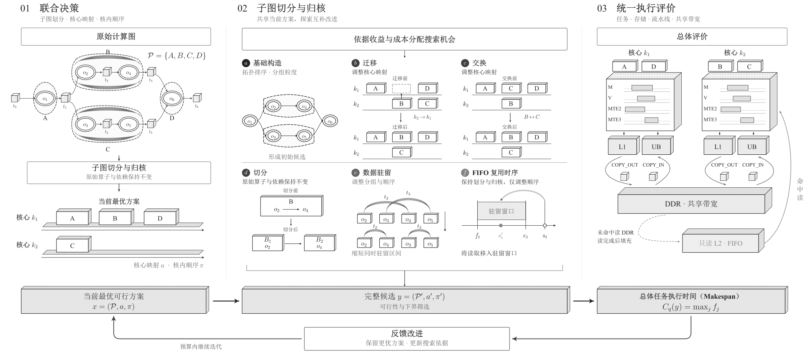

# 图1.1 · 第九版（ink_v9）

基于已合并第八版，仅删除红框所示的五组正面底部横条纹。只新增本目录，不覆盖旧版、PR #69论文、求解代码或实验数据。

## 本轮唯一图形修改

删除左右两侧L1、UB底部的4组横纹，以及DDR正面底部的1组横纹。直接移除5个SVG路径（合计38条水平线），不是白色遮盖，也不是重新绘制整图。

正面底色和边框、顶面与侧面斜纹、所有COPY_OUT/COPY_IN文字及四个张量小立方体、箭头、字体、01/02/03布局和底部反馈闭环全部保留。四套配色同步完成，只有颜色不同，几何及文字一致。

## 四套配色与文件

### 青绿·赭石

[矢量PDF](exports/workflow_qinglu_v9.pdf) · [便携SVG](assets/workflow_qinglu_v9.svg) · [可编辑SVG](assets/workflow_qinglu_v9_editable.svg) · [SVGZ](assets/workflow_qinglu_v9.svgz) · [高清PNG](exports/workflow_qinglu_v9.png)

### 浅绛·苔色

[矢量PDF](exports/workflow_qianjiang_v9.pdf) · [便携SVG](assets/workflow_qianjiang_v9.svg) · [可编辑SVG](assets/workflow_qianjiang_v9_editable.svg) · [SVGZ](assets/workflow_qianjiang_v9.svgz) · [高清PNG](exports/workflow_qianjiang_v9.png)

### 烟岚·石青

[矢量PDF](exports/workflow_yanlan_v9.pdf) · [便携SVG](assets/workflow_yanlan_v9.svg) · [可编辑SVG](assets/workflow_yanlan_v9_editable.svg) · [SVGZ](assets/workflow_yanlan_v9.svgz) · [高清PNG](exports/workflow_yanlan_v9.png)

### 墨线·灰阶

[矢量PDF](exports/workflow_mono_v9.pdf) · [便携SVG](assets/workflow_mono_v9.svg) · [可编辑SVG](assets/workflow_mono_v9_editable.svg) · [SVGZ](assets/workflow_mono_v9.svgz) · [高清PNG](exports/workflow_mono_v9.png)

SVG画布3500×1550；PDF物理尺寸490×217毫米；高清PNG为6000×2657，预览为2100×930。PDF为单页纯矢量图。

## PR #69论文配套文字

[可直接使用的正文与插入说明](docs/PAPER_TEXT_PR69.md) · [LaTeX图文替换片段](docs/PR69_figure_and_text.tex)

PR #69已经合并。替换现稿 `20hw_myskill_distribution/20hw_myskill_distribution/workshop_v2/论文/章节内容/01_问题重述.tex` 中原有 `fig:roadmap` 图环境及其后两段说明，避免重复标签。LaTeX片段已指向第九版青绿PDF。

正文保留a—f候选操作、三问使用范围、统一评价与反馈、双核COPY标注及只读L2语义。删除装饰横纹无需写入论文正文。本次提供可插入材料，没有直接修改或重新编译80页论文。

## 字体与可编辑性

便携SVG和PDF直接沿用第八版SimSun、Times New Roman及Computer Modern字形轮廓，不重新排字。可编辑SVG保留102个文字对象。交付不包含字体文件。

## 重建与核验

```bash
python -m pip install pymupdf pillow
# 系统安装Inkscape；保留相邻的已发布ink_v8目录
python paper_a_figures/engraved_workflow/ink_v9/build.py --all
python paper_a_figures/engraved_workflow/ink_v9/verify.py
python paper_a_figures/engraved_workflow/ink_v9/pixel_check.py
python paper_a_figures/engraved_workflow/ink_v9/review.py
```

`build.py`核对八份V8源SVG的Git blob值。`verify.py`把五个删除对象恢复至原索引并还原版本元数据后，要求XML序列化结果与第八版完全相同；同时检查颜色归一后的几何一致性、引用和矢量导出。`pixel_check.py`采用同一Inkscape渲染V8/V9，要求五处目标区域之外变化像素数为0。`review.py`用独立MuPDF渲染全部PDF并生成整图/局部审阅图。`prepare_from_v8.py`保留了配套脚本与正文模板的派生过程，常规图件重建无需重复执行。

[审阅记录](docs/LOCAL_REVIEW.md) · [对象核验](docs/OBJECT_REVIEW.json) · [像素核验](docs/PIXEL_REVIEW.json) · [四色整图](docs/four_palettes_review.png) · [四色存储细节](docs/four_palettes_memory_detail.png) · [青绿局部](docs/detail_memory_clean.png)
